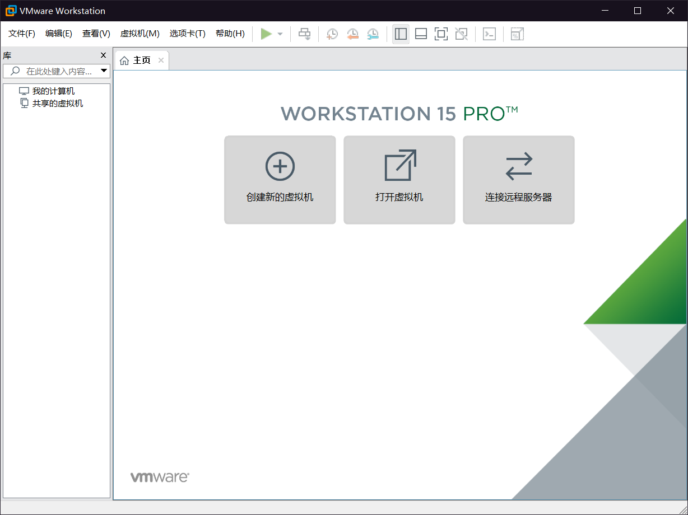
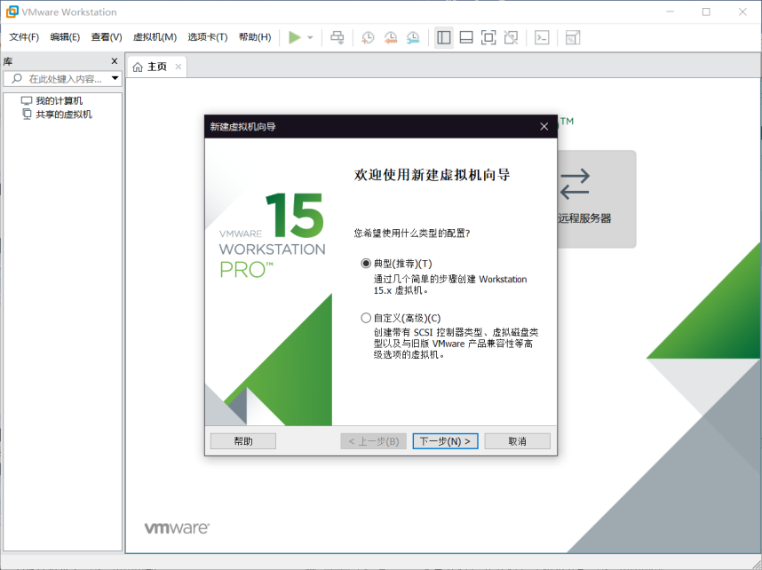
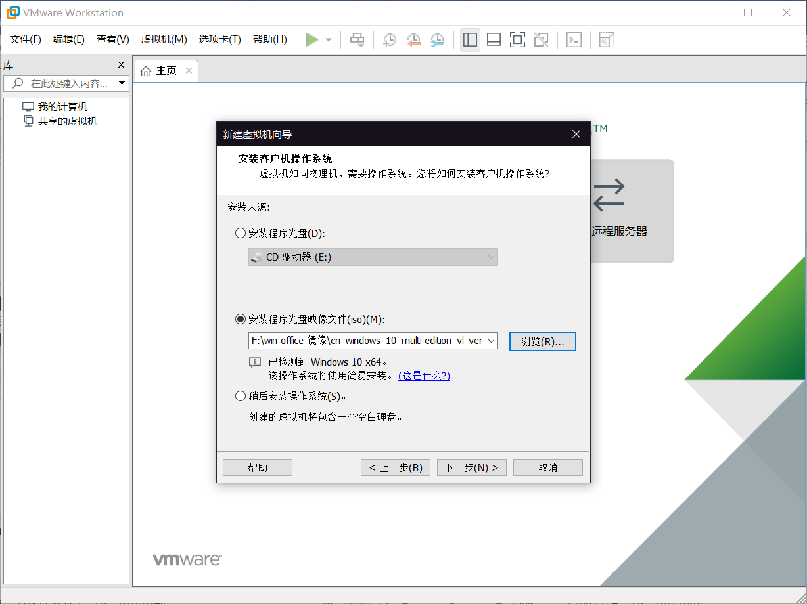
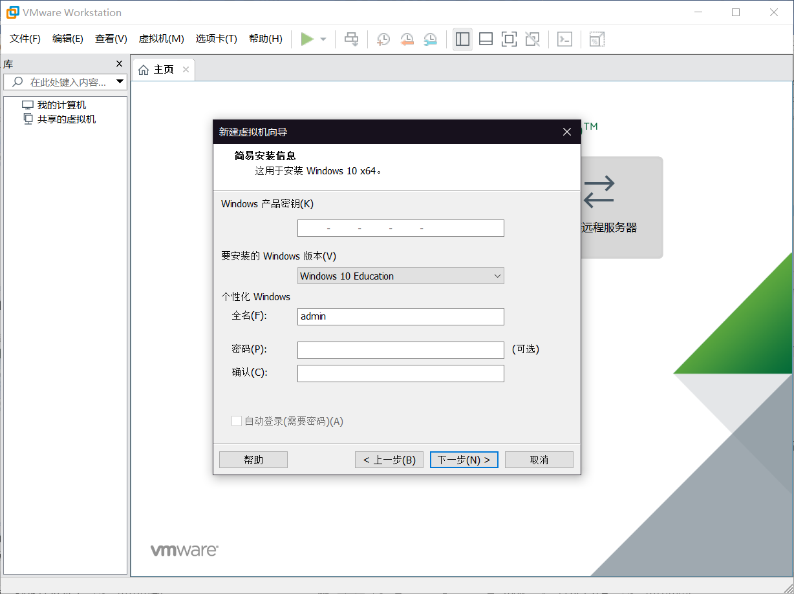
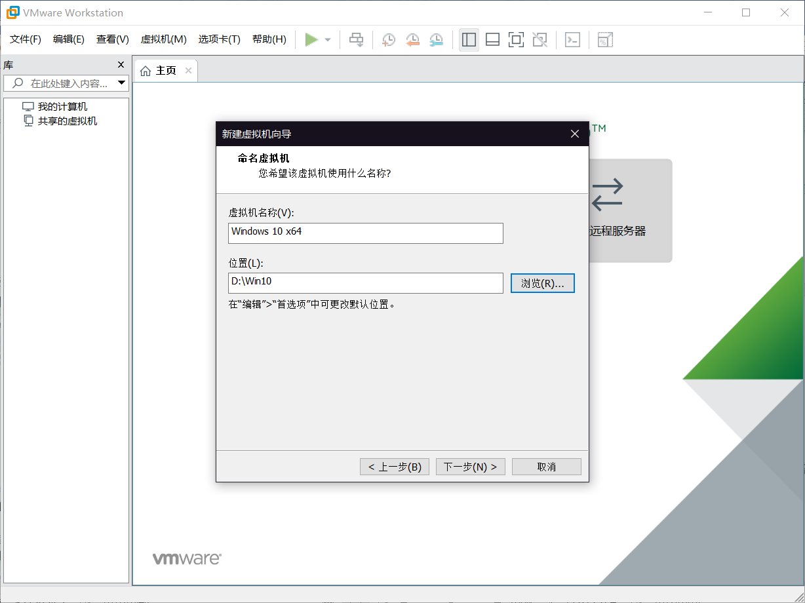
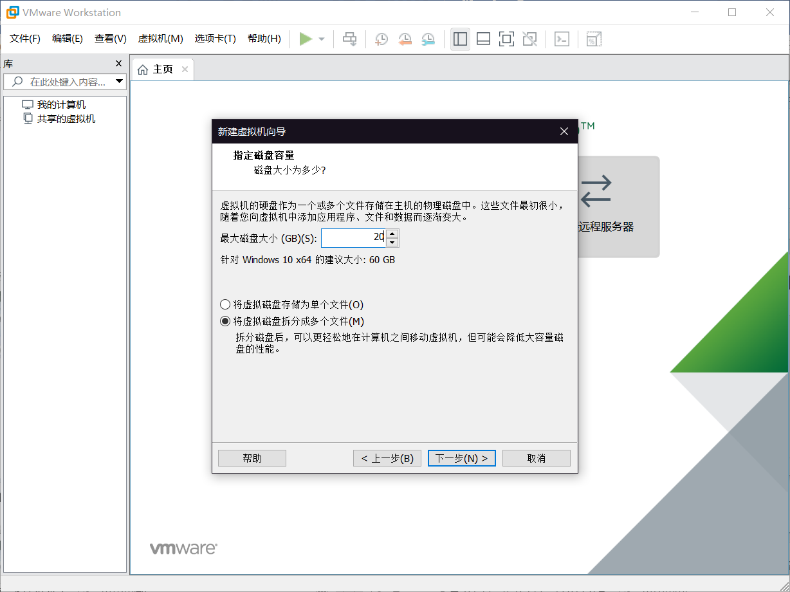
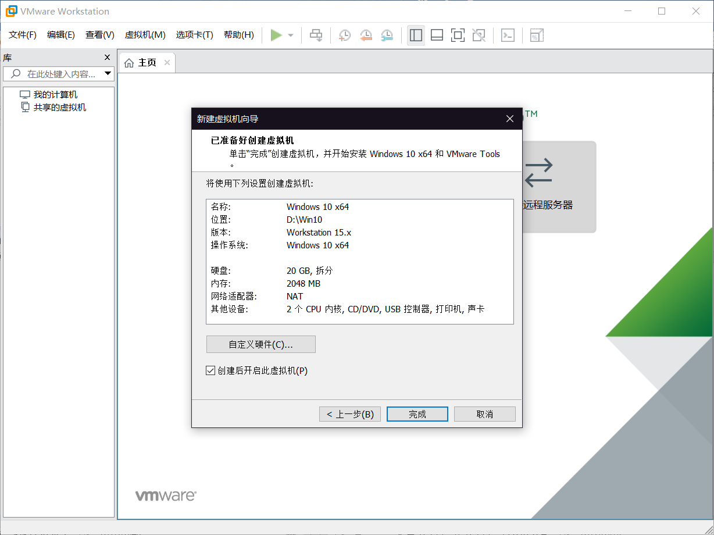

# 创建和使用虚拟机

首先说一下虚拟机吧，虚拟机指通过软件模拟的具有完整硬件系统功能的、独立运行的计算机系统。目前流行的虚拟机软件有 VMware、Virtual Box 和 Virtual PC。

虚拟机的常用用途：

1. 演示环境，可以安装各种演示环境，便于做各种例子。

2. 保证主机的快速运行，减少不必要的垃圾安装程序，偶尔使用的程序，或者测试用的程序在虚拟机上运行。

3. 给不经常使用的软件建一个独立的环境，避免反复安装。

4. 在虚拟机中测试不熟悉的软件。

5. 体验不同版本的操作系统，如 Linux、Mac。

## 用 VMware Workstation 创建虚拟机

我们这一节介绍一下 VM 的大致安装操作。 打开 VM，选择“创建新的虚拟机”

上面是标准（典型），下面是自定义，一般情况下我们选择“标准”就可以了。

这一步是安装操作系统，选择相应的镜像文件即可。

为设置用户名和密码（Win 产品密钥可以稍后输入）

为虚拟机命名和设置这个虚拟机的存放位置

这里是设置虚拟机的硬盘大小，以及文件保存方式，各有优点。

创建即将完成

## VMware Workstation 与 VirtualBox

VirtualBox 的安装过程与 VMware Workstation 大体类似。两者都可按虚拟机软件和客体系统的支持情况配置共享文件夹、拖放、快照等功能。

需要让两个系统分别在实体硬件上运行时，参见[双系统安装与启动](../software/dual-boot-virtualization.md)。
