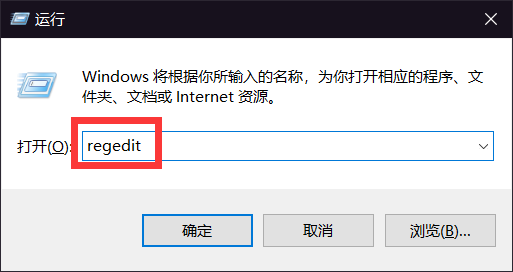
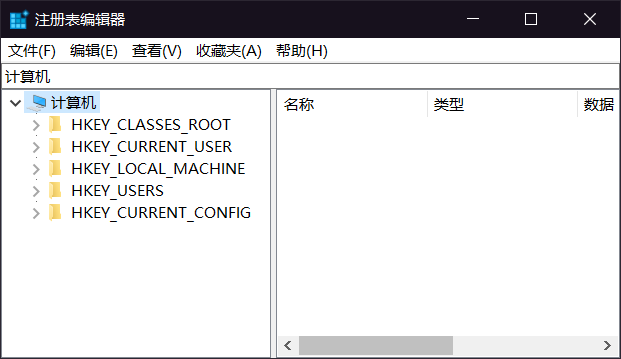
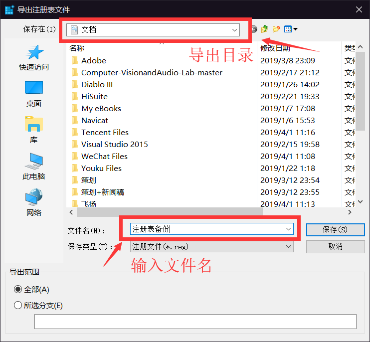
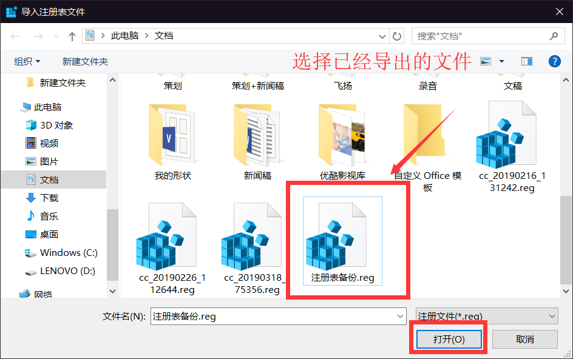
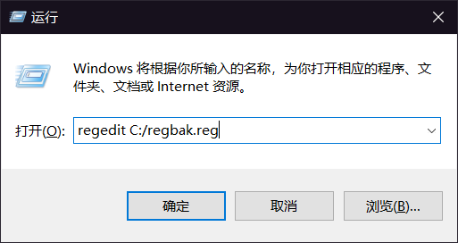
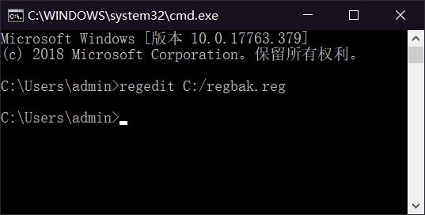

# Windows 注册表与 .reg 文件

## 注册表的由来

注册表是 Windows 内部一个巨大的树状分层的数据库，其中容纳了应用程序和计算机系统的全部配置信息，包括操作系统和应用程序的初始化信息、应用程序和文档的关联关系、硬件设备的说明、状态和属性以及各种状态信息和数据。

### 注册表编辑器

注册表编辑器是一个用来查看和编辑注册表数据的高级工具。通过该工具，用户可在注册表中添加或修改数据，从而改变系统设定。

打开方式：选择“开始” → “运行”菜单（也可以按 win + R 快捷键），在运行窗口中输入 Regedit，单击“确定”按钮，即可打开注册表编辑器。





### 键和值

在 Windows 系统中，注册表采用“关键字”和“键值”来描述项目及其项目值。在注册表中，关键字可以分为两类：一类是系统自定义的，通常称为“预定义关键字”另一类是由应用程序定义的，安装的应用软件不同，其项目也就不同。

注册表中的数据都是通过一种树状目录结构，以根键、主键和子键的方式组织起来的。每个键都包含一组特定的信息，在注册表中，用来表示这些信息的数值被称为键值项。

### 五个常见根键

#### HKEY_CLASSES_ROOT 根键

每一种在系统中注册过的文件类型，都会在此建立一个子项；而且在每一个子项中均包含了文件的扩展名、说明性文字、文件图标及与文件关联的应用程序和应用程序对文件的操作方式。

#### HKEY_CURRENT_USER 根键

保存着当前登录用户的个人设置信息，如显示属性设置、网络连接和共享设置、应用程序参数设置等。当前登录用户可以利用该根键来修改这些设置，而不影响其他用户。

#### HKEY_LOCAL_MACHINE 根键

存放着用来控制系统和各软件的设置信息。该根键中的设置都是针对所有用户的，而且其中的信息会因计算机系统软、硬件配置的不同而不同。

#### HKEY_USERS 根键

与 HKEY_CURRENT_USER 根键的作用相似，不同的是其包含的是所有用户的个人设置信息。

#### HKEY_CURRENT_CONFIG 根键

当在 Windows 中配置多个硬件配置文件时，系统启动时会让用户选择使用哪个配置文件登录，HKEY_CURRENT_CONFIG 根键的作用是存放当前配置文件的所有信息。

### 导入/导出注册表

#### 导出注册表

作用：备份注册表，以便在出现问题时恢复。

方法：打开注册表编辑器，选择“文件” → “导出”菜单，打开“导出注册表文件”对话框，然后执行下图所示操作，然后点击“保存”。



#### 导入注册表

作用：注册表出现问题时将其恢复。

方法：打开注册表编辑器，选择“文件” → “导入”菜单，打开“导入注册表文件”对话框，然后执行下图所示操作。



也可以按提示双击导入可信的注册表文件，或使用命令行导入。导入会合并配置，修改后新建的值需要另行移除。

**1.** 在“运行”对话框可以打开 `regedit`，按提示选择并导入要恢复的文件。



**2.** 使用命令行时，可在“运行”对话框输入 `cmd`，再执行 `reg import "C:\regbak.reg"`。



## REG 文件编写

REG 文件通常用文本编辑器编写。下面用当前用户下的演示键说明文件头、键路径和 DWORD 格式。

```reg
Windows Registry Editor Version 5.00

[HKEY_CURRENT_USER\Software\FeiyangWiki\Example]
"Mode"="demo"
"Enabled"=dword:00000001
```

文件头和后面的键路径之间留一个空行。保存时将类型选为“所有文件”，文件扩展名用 `.reg`。字符串值用双引号包起来。DWORD 采用十六进制，例如数值 0 写为 `dword:00000000`。

路径左方括号后如果紧跟减号，表示删除整个键和子树。值名后等号右侧只有减号时，则只删除该值。导入前应确认范围。
