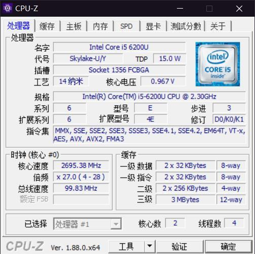
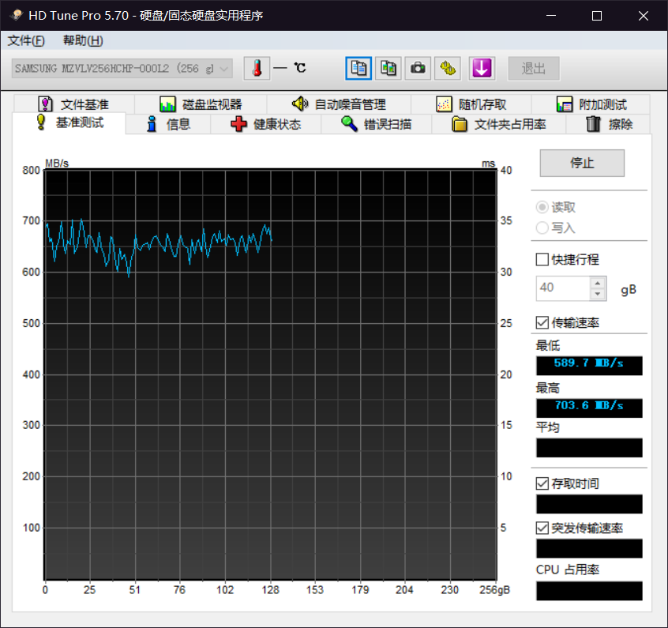
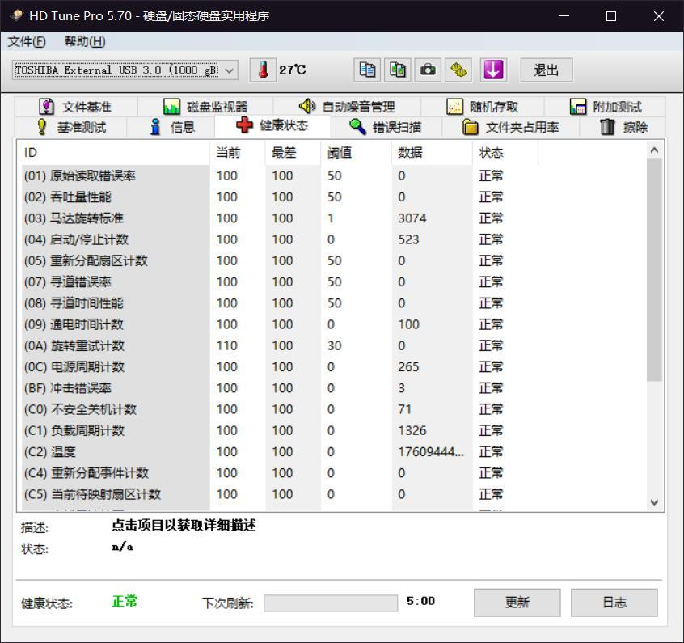
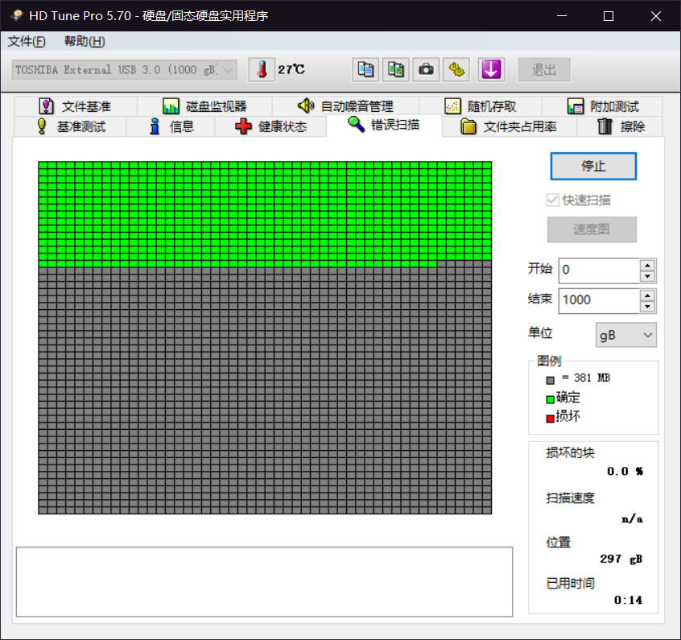
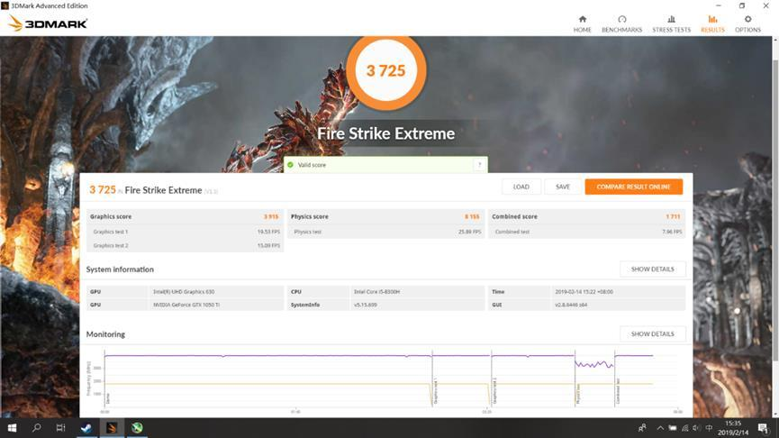

# 硬件检测、健康检查与压力测试

## 硬件检测工具

### CPU 检测工具——CPU-Z

CPU-Z 是当时常用的 CPU 轻量级检测工具，它庞大的CPU 数据库几乎涵盖了市面上所有的商业级CPU，可以快速方便地给用户提供极为详尽的本机CPU 信息，包括核心频率，当前设置倍频等及时信息。

除了对CPU 检测外，现在新版的CPU-Z 也提供了基础的内存检测和显卡检测，在无其它专业工具的情况下也能提供相应的信息。

下图是手册所用版本 CPU-Z 的主界面（因为CPU 产品更新速度较快，所以也需要及时对CPU-Z 及时更新）。我们可以看到它提供了很多的选项卡，使用时只需要选择相应的选项卡就能看到相应的信息了。

另外，在窗体的右下角我们可以看到一个“认证”按钮。在联网的情况下，单击这个按钮后，它会把你的CPU 信息上传到CPU-Z 的官网进行比对以验明“正身”。

### 显卡检测工具——TechPowerUp GPU-Z

显卡是决定现代的个人电脑性能的一个重要组件，我们无论是在DIY 攒机或是给客户导购笔记本的时候都必须把显卡放在一个比较重要的位置来考虑。GPU-Z 是一款被广泛使用的权威显卡检测工具，它体积小，检测速度快，检测信息准确，而且还提供了Sensors 功能，能实时反馈显卡的温度（GPU temperature），VDDC，显存频率(memory clock），核心频率（core clock）等等信息。

GPU-Z 的 Graphics Card 页给出了显卡的信息。我们平常经常使用的是以下八个区域：

1. 名称（name）：这里显示的是机器内所使用显卡的型号，例如这幅图所用的就是核显Intel HD Graphics 520。

2. 显卡核心（GPU）：这表示这款显卡所使用的显卡核心型号。

3. 着色单元（Shaders）：显示流处理器数量，是衡量显卡渲染能力的一个指标。

4. DirectX 支持（DirectX support）:DirectX 是微软开发的游戏编程接口,这里显示了显卡所支持的DirectX 的版本。

5. 这里显示了显卡输入输出以及内存储的相关信息,包括像素填充率(Pixel Fill rate),纹理填充率（Texture Fill rate），显存大小（memory size）,显存类型（memory type）,显存位宽（bus width）,显存带宽（bandwidth）。

6. 频率区。包括时钟频率，内存频率，流处理器频率。上面一行为当前值，下面一行为默认值。

7. 这里表示这款显卡所支持的一些技术，如是否支持交火（crossfire），sli，physx，cuda 等。

8. 这里可以选择当前查看显卡，如果是多显卡用户可以切换查看不同显卡的信息。

### 硬盘检测工具——HD Tune

HD Tune 是目前比较常用的轻量级硬盘检测工具，它可以进行硬盘的读写速度测试，健康状态测试等等测试。传输能力测试包括基准测试，文件基准测试，随机存取测试等，能够比较全面的衡量硬盘的性能。它可以利用硬盘的s.m.a.r.t 技术报告硬盘的现有健康状态并可以检测硬盘坏道。

#### 基准测试

在基准页面选择读取或写入开始测试，蓝色曲线表示传输速率，黄色点表示存取时间（越短越好）。对于一般的硬盘来说蓝色曲线的平滑度能衡量一个硬盘读写的稳定性，固态硬盘的测试曲线除了传输速率要远远高于机械硬盘外也平滑稳定的多。写入测试因为存在风险，有数据的磁盘优先只读测试。

#### 查看硬盘信息

信息选项卡显示了硬盘的基本信息和相关参数，可以与商家提供的资料进行比对防止上当受骗。

#### 磁盘健康

#### 坏道检测

对于机械硬盘而言，常常会因为出现坏道而影响正常的使用，我们在错误扫描内可以检测硬盘是否存在坏道。一般而言，我们都会先勾选快速扫描，因为否则正常状态下坏道检测速度会非常慢。如果发现了存在坏道再在正常状态下扫描。图上绿色方块表示该区域正常，红色表示存在坏块，如图。

## 烤机工具

### CPU 烤机工具——AIDA64

AIDA64 是一款测试软硬件系统信息的工具，它可以详细的显示出PC 的每一个方面的信息。AIDA64 不仅提供了诸如协助超频，硬件查错，压力测试和传感器监测等多种功能，而且还可以对处理器，系统内存和磁盘驱动器的性能进行全面评估。

AIDA64 是一个为家庭用户精简的Windows 诊断和基准测试软件。 AIDA64 提供了一个范围广的特点，协助在超频，硬件错误诊断，压力测试，和传感器监测。它具有独特的能力来评估处理器，系统内存和磁盘驱动器的性能。AIDA64 是兼容所有的32位和64 位微软Windows 操作系统，包括Windows 7 和Windows Server 2008 R2。

### 显卡跑分软件——3DMark

GPU 性能检测我们只介绍最权威的显卡跑分软件——3DMark。这是国内外每个硬件爱好者都非常熟悉的一款软件，它拥有非常先进的算法，极端模式更是高端显卡的噩梦。

现在最常用的版本是3DMark11 和3DMark Vantage。而最新版本的3DMark（官方新版的名字就叫3DMark 而不是3DMark12 等等）支援桌面与移动平台的跨平台测试，支援windows、Android、iOS 与WindowsRT 系统平台的测试，且取消了统一的总分，只提供四个场景分。

