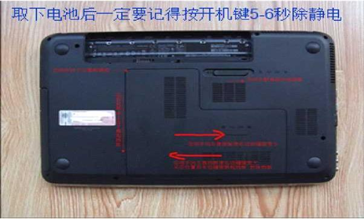
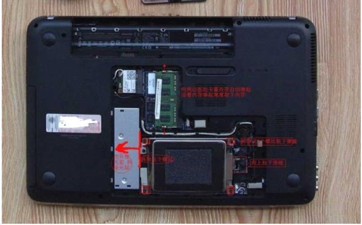
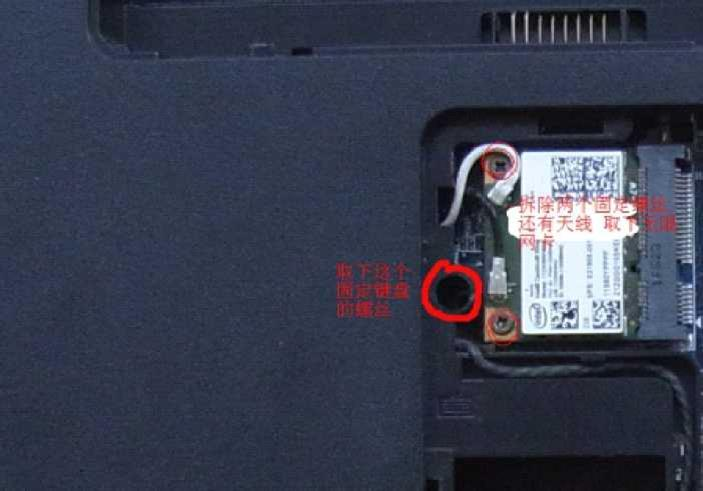
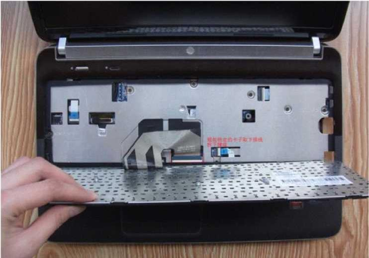
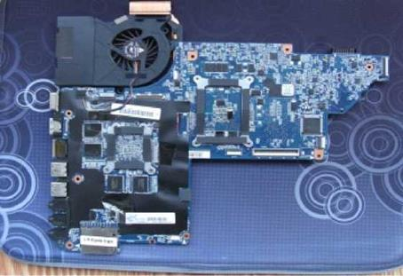
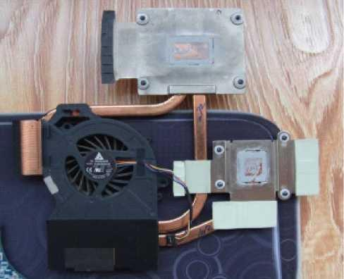

# 笔记本拆机清灰与复装检查

!!! note "机型不同，拆装顺序也不同"
    原手册使用的是带可拆电池和光驱的笔记本。动手前先看[拆机准备与连接器](laptop-disassembly.md)。拆过散热器时按厂商说明处理硅脂和导热垫，清理风扇时固定叶片，复装完成再通电。

下面以一台机器的拆解进行拆机过程的讲解：

## 拆下底盖与模块

### 1. 移除电池与底盖

关机、拔掉外接电源，并按该机型的维修手册断开电池。原手册的示例机型还需要拆下D 面可拆卸的面板，一般其下会有内存条。

图中所说的“除静电”是指释放机器的残余电荷。防静电措施请另按厂商的维修说明执行。

### 2. 取出内存、光驱和硬盘

按下内存条两边的金属扣，内存条即倾斜，此时将其取出；拆除固定光驱的螺丝，向外滑动，取出光驱；拧开硬盘四周的固定螺丝，向上拔出排线（图中机型的连接方式见图示），即取下硬盘。

同时，对于取下的内存条请妥善保管，置于干净的环境中最佳。

### 3. 拆无线网卡和天线

拧开无线网卡的两颗固定螺丝（也可能是一颗），用镊子向上提一白一黑两根天线与网卡的接头处，取下天线，无线网卡即会倾斜，同取内存一样，取出即可。

PS：无线网卡的螺丝推荐和无线网卡一起保存，以防螺丝混淆；

拆除天线前请记好天线顺序，以防顺序装反，可以通过拍照来记录位置。

## 拆下键盘与主板

接下来我们拆键盘，拆键盘是需要观察和一定巧劲的，大家千万不可上蛮力，一开始我们要耐心点。首先观察键盘与C 面的接合方式，寻找突破口（一般在键盘上方）用拆机片或指甲斜进C 面，将卡扣逐个解除，在上方键盘松开的同时，注意一并解除左右的卡扣，最后应该是如下图所示，键盘基本已经脱离C 面，除了一根键盘的宽排线，拆下排线，键盘即拆卸完毕了。

同样，键盘拆下后请妥善保管，拆键盘是一件需要实际经验的活，大家以后在拆机过程中可以好好体会下。

### 4. 卸下键盘下的螺丝与排线

拧下键盘下的所有螺丝，并合理正确地拿下可见的排线，如触摸板、电源键等的排线。

### 5. 移出主板

拧下主板上将其固定在D 面的螺丝，取下可见的排线，如USB 和电源线等，可能还需拆除蓝牙模块，之后轻轻晃动下主板，观察是否松动，确定无误后，我们即取下主板。

## 清理散热模块

### 6. 取下风扇和散热器

我们就快完成目标了；此时只需对刚刚拆下的主板操作了，我们用镊子取下风扇与主板的排线，拧松覆盖在CPU 和显卡芯片上金属片的固定螺丝（一般这些螺丝垫有弹簧，可以不拆下），之后便从主板上完全取下了散热模块；

之后拧下风扇的固定螺丝，分解风扇，可以用皮老虎对着风扇和出风口（这里一般是灰尘积聚的地方）火力全开！清灰除尘！

此外我们观察CPU 和显卡芯片上的金属片上的硅脂是否干燥，如果不是很湿润，那么它已经起不到导热的作用了，我们将这层旧硅脂清理掉，涂上一层新的，涂的厚度正好便可。配置好些的笔记本上是一层淡黄色、较平整的胶片，它可以不用换。而硅脂是灰色糊状物，如下图所示的物体，它已经不能导热了。

## 复装与测试

### 7. 按相反顺序装回

最后按与上述相反的步骤重新组装笔记本，即将散热模块重新组合，装到主板上（注意插上风扇的排线），将主板固定好在D 面上（注意各归原位），将 C 面合上（与 D 面相连的螺丝上好，排线插紧），将内存条插紧。检查排线、螺丝和风扇线是否已装回原位，再完成复装。

接着把无线网卡、光驱装好，还原D 面。

随后，我们应打开电脑，检测机器是否正常。若无法启动或有异响，先关机断电，再检查复装步骤。

## 台式机拆装

### 8. 断电并记录线路

台式机的拆装：台式机的拆解很大程度上就是拆解主机。拆解主机前切记断电，其与硬件的拆卸方法与笔记本类似。不同的是台式机内线路众多，所以拆卸时切记接口所接的具体线路以方便之后的组装。

来源：四川大学飞扬俱乐部《维修手册》第六章第二节，印刷页 133–137。
