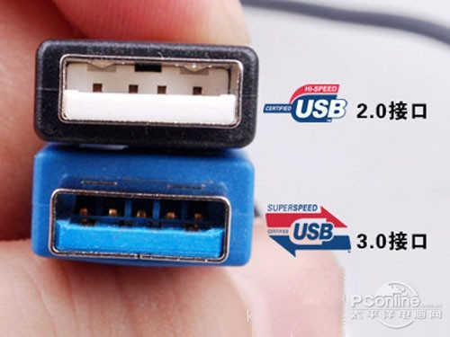
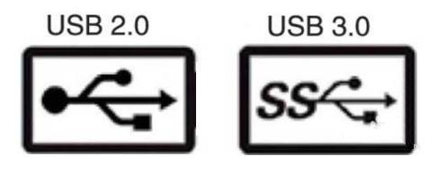

# GB、GiB 与 USB 接口

## GB 和 GiB

我们往往买到的U 盘标注的容量和最终到手的容量不相符。其实就是计量单位的不同，一个为GB，一个为GiB。我们就来分别讲一下这两个计量单位。

GB：吉字节（GB、Gigabyte，在中国又被称为吉咖字节或京字节或十亿字节或戟），常简写为G，是一种十进制的信息计量单位。吉字节（Gigabyte）常容易和二进位制的信息计量单位Gibibyte 混淆。常使用在标示硬盘、存储器等具有较大容量的储存媒介之储存容量。

**1 GB = 1,000 MB = 1,000,000 kB = 1,000,000,000 B。**

GiB：Gibibyte（giga binary byte 的缩写）是信息或计算机硬盘存储的一个单位，简称GiB。“GiB”、“KiB”、“MiB”等是于1999 年由国际电工协会（IEC）拟定了"KiB"、“MiB”、“GiB"的二进制单位，专用来标示“1024 进位”的数据大小。而后，这一标注规范又于2008 年并入国际标准化组织（ISO）文件。具体的来说,1GiB=1024MiB，1MiB=1024KiB。他们与GB、MB、KB 是不一样的，GB 等则是1000 进位的数据单位。

## USB 2.0 和 USB 3.0

如今，我们在挑选U 盘的时候，除了U 盘的容量之外，还有一个重要的指标就是USB的接口是2.0 还是3.0。

其实USB 2.0 和USB 3.0 最重要的性能差别就是传输速度上的差别。USB 3.0 的传输速度要高于USB 2.0 的。同时USB 3.0 也是向下兼容USB 2.0 的。但是，要实现USB 3.0 的满速传输，必须具备两个条件，首先电脑主板支持USB 3.0，另外一个使用的设备也必须支持USB 3.0。

举个例子：如果电脑主板接口为USB 3.0 我们拿个USB 2.0 的U 盘，连接到USB 3.0接口上，但是传输速度依然只有USB 2.0 的速度。因为即便主板满足要求，但U 盘没达到。因此依然只能到USB 2.0 的传输速度。反过来，如果你拿一个USB 3.0 的U盘，连接到USB 2.0 接口上，那么传输速度依然只能到USB 2.0，因为主板最高只支持到2.0 的速度。

说完了USB 2.0 和USB 3.0 的性能区别之后，我们怎么区分它们呢？

### 外观

部分 USB 3.0 接口使用蓝色塑料片，USB 2.0 则常见黑色或白色。不同设备的配色可以相同。

### 引脚

USB 3.0 的标准 Type-A 接头的针脚是9 针，而USB 2.0 的标准 Type-A 接头则是 4 针。为了兼容2.0 版本，USB 3.0 采用了9 针脚的设计，其中四个针脚和USB 2.0 的形状、定义均完全相同，而另外5 根是专门为USB 3.0 准备的。

### 标志

USB 2.0 的标志和USB 3.0 的标志有一定区别，USB 3.0 有一个SS 标志，意思是SuperSpeed，部分的设备上面会有这个标志。

