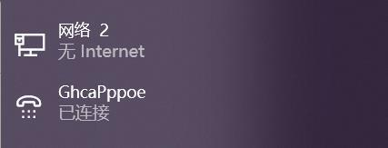
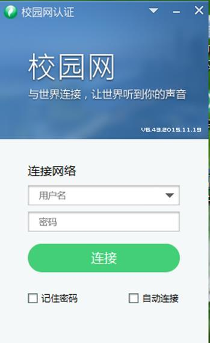
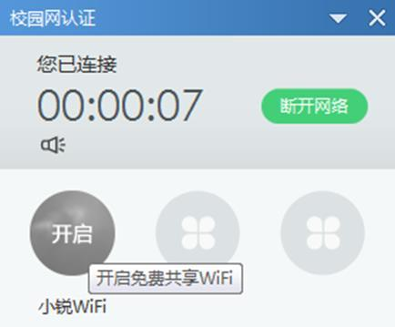

# 四川大学校园网接入与排障

连接川大校园网或查询认证、报修，请看[四川大学信息化办校园网服务说明](https://info.scu.edu.cn/index/jsfw/xyw.htm)。校方当前公布的无线网络名称为 SCUNET。网络故障可拨打 028-85410000，或从「四川大学微服务」的「信息化应用报修平台」报修。

## 2019 年校园网接入方式

### 江安校区上网

#### 无线上网

**移动 CMCC-EDU**

需要办理移动的电话卡并办理套餐，不同套餐上网时长和价格均不同，详情咨询移动营业厅。少部分寝室 CMCC-EDU 信号较弱。寝室地区 CMCC-EDU 偶有抽风，会出现无法打开登录页面或登录后无网速现象。

**SCUNET**

学校搭建的 SCUNET 无线网络已经实现教学楼和食堂地区的覆盖。每人每月会赠送一定时间的上网时长：100 小时。

注意：因为无线网络连接有端口上限，所以在人多的教室内，SCUNET 也会出现无法登录或登录后没有网速的情况。

#### 有线上网

**校园网**

连上网线，选择 GhcaPppoe 或是宽带连接均可（以 Windows 10 为例）

校园网带宽是 512kb，网速相当慢，但上校内网会很快，所以一般用来选课或登录学校网站，如果想用较快的校园网，推荐凌晨无人时使用。

连接校园网可以通过学校图书馆的官方网站进入学校已经购买的数据库进行论文的搜索与下载。

经许多同学的试验，校园网虽然网速很慢，但是确实能够满足一般的网络游戏的需求。

### 望江、华西校区上网

因为，望江、华西校区的无线上网和江安校区相同，在此不多赘述。

#### 有线上网

**校园网**

（望江校区校园网并不是和江安校区一样一直免费，而是每人每月都有一定的免费上网时长，不过速度比江安快很多）望江校区的校园网上网与江安校区有着较大的区别，首先需要在学校信息管理中心网站：`http://imc.scu.edu.cn/how/khdxgxz.html` 去下载客户端。

双击打开客户端，使用当时的校园网账号登录后即可上网。

校园网用户可以使用个人校园网上网账号及密码登录网址：`http://self.scu.edu.cn:8080/selfservice/`

对校园网个人用户信息（密码）、余额、账务流水及套餐进行查询和更改，自助系统服务时间：06:00~20:30。

**网络分享**

望江新版的校园网客户端支持将网络分享给一台移动设备使用，具体做法为：

1. 登录校园网

2. 点击小锐 WIFI 开启按钮，会自动进行应用安装，等待安装程序自动安装完成。

    

3. 对各自的 WIFI 进行名称、密码设定。

4. 设定完成后，即可对各自的校园网进行 WIFI 共享（1 台个人电脑只能共享给 1 个移动端使用）

如果网络认证后仍不通，可继续按[连接故障与 ping 诊断](ping-browser.md)记录现象。
