# 家庭网络与路由器排障

## 常用网络修复工具原理

### 360 断网急救箱

以 360 断网急救箱为例，360 断网急救箱是 360 安全卫士自带的一个简单易用的内置网络修复软件，只需轻轻一点，即可解决大多数网络未连接问题。这是 360 断网急救箱的主页面：

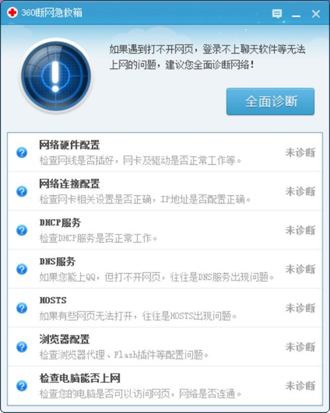

可以看到 360 断网急救箱的修复内容包括 7 项，下面让我们来逐个了解下吧！

1. 网络硬件配置：检查网线是否插好，网卡及驱动是否正常等。网线不用说，这种情况下断网急救箱会直接跳出；能否上网，网卡是一个至关重要的硬件，如果检测网卡损坏，那么只能通过更换网卡来修复；若是网卡驱动损坏，可以从网上下载最新驱动安装或直接卸载重启，电脑会自动安装本机自带驱动。

2. 网络连接配置：检查网卡相关设置是否正确，IP 地址是否配置正确。

    - 网卡相关设置一般是检测网卡的无线开关是否处于打开状态；

    - 检测 IP 地址是否可用，或是否与在用电脑的 IP 地址重合；

3. DHCP 服务：检查 DHCP 服务是否正常工作。从前面可以知道 DHCP 是给内部网络或网络服务供应商自动分配 IP 地址，如果 DHCP 服务器不能正常工作，计算机就不能顺利从 DHCP 服务器得到正确的上网地址，也就无法登录局域网的指定域了，这时就会导致网络无法连接。

4. DNS 服务：如果您能上 QQ，但打不开网页，往往是 DNS 服务出现问题。DNS 可以将网站域名转换为 IP 地址，从而达到上网目的。如果 DNS 未正确设置，则此过程不能完成，网页将不识别主机，这也就是明明感觉有网，但就是打不开网站的原因了。导致 DNS 设置错误的原因很多，可能是连网时获取 DNS 出错或 DNS 服务器本身问题，还有一种可能，是本地 DNS 缓存出现了问题。为了提高网站访问速度，系统会自动将已经访问过并获取 IP 地址的网站存入本地的 DNS 缓存里，一旦再对这个网站进行访问，则不再通过 DNS 服务器而直接从本地 DNS 存取出该网站的 IP 地址进行访问。

5. Hosts：Hosts 文件被修改也会导致浏览不正常，表现为访问某些网页缓慢或无法连接。这时可以检查网页域名与 IP 地址的映射关系。

6. 浏览器配置选项：检查浏览器是否配置了代理服务器，以及旧版 Flash 插件是否影响网页加载。

    - 设置代理服务器的作用：设置用户验证和记账功能，可按用户进行记账，没有登记的用户无权通过代理服务器访问 Internet 网；增加缓冲器(Cache)，提高访问速度，对经常访问的地址创建缓冲区，大大提高热门站点的访问效率；节省 IP 开销:代理服务器允许使用大量的伪 IP 地址，节约网上资源，即用代理服务器可以减少对 IP 地址的需求。简单地说代理服务器就是起到一个加速作用，如果未设置就会出现浏览网页变慢等问题。

    - Flash 设置导致网页变慢是由于浏览器对刷新图片的限制，使得某些网页迟迟刷不开。

7. 强力修复：强力修复是还原电脑的一切网络设置，默认你的电脑一开始就能上网的。

### 手动设置 IP 地址与 DNS

1. 在控制面板中打开“网络和 Internet”

    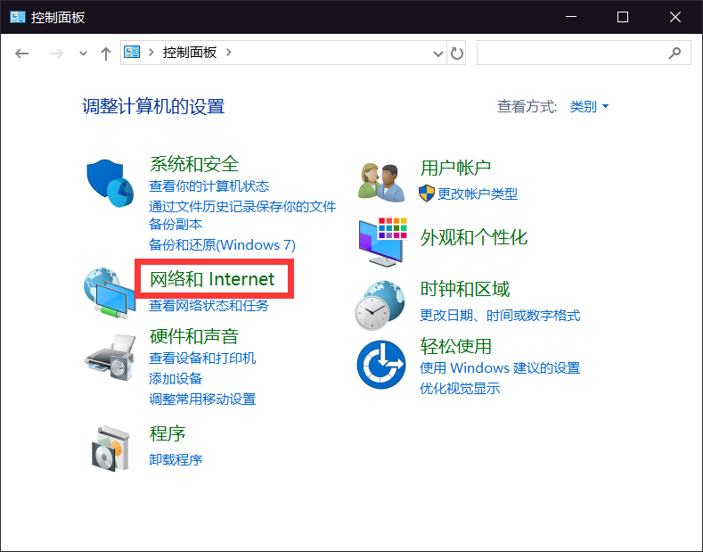

2. 选择“网络和共享中心”

    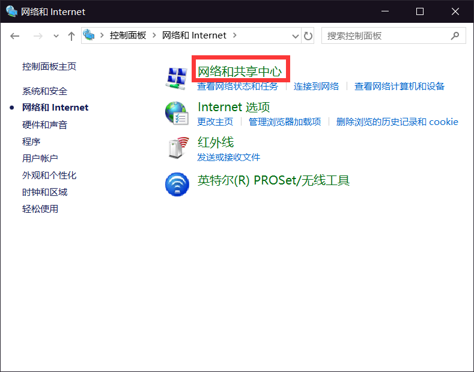

3. 选择“更改适配器设置”，在网络连接列表里右键要调整的连接，再选择“属性”。

    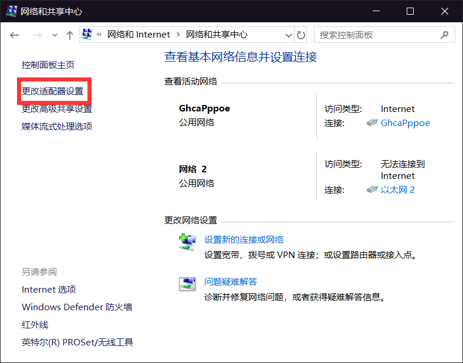

    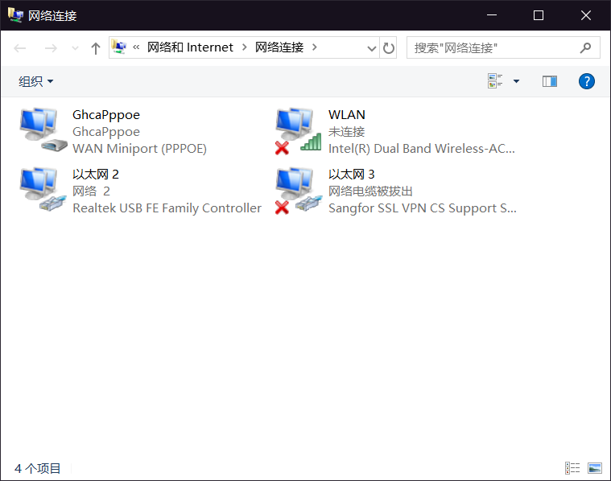

4. 找到“Internet 协议版本 4（TCP/IPv4）”，双击进入编辑模式。

    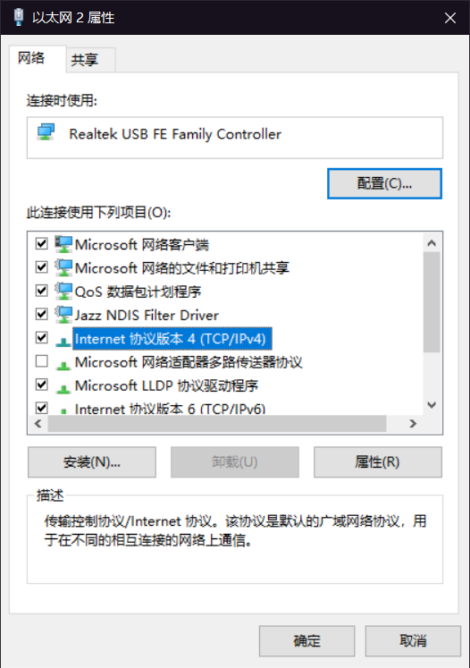

5. 接着便可以更改 IP 地址及 DNS。如果接入的网络使用 DHCP，按网络要求选择自动获取即可。

    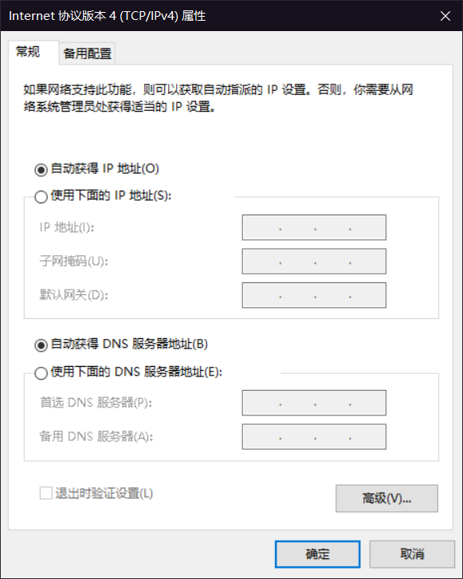

## 无线路由器设置

### 路由器概述

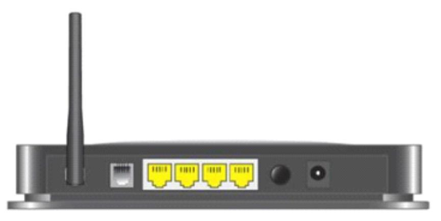

外部：一个 WAN，四个 LAN，一个电源接口，一个 reset，QSS 按键

下面介绍一些常用的简单设置：

1. 打开设置向导按照提示进行操作，很简单

    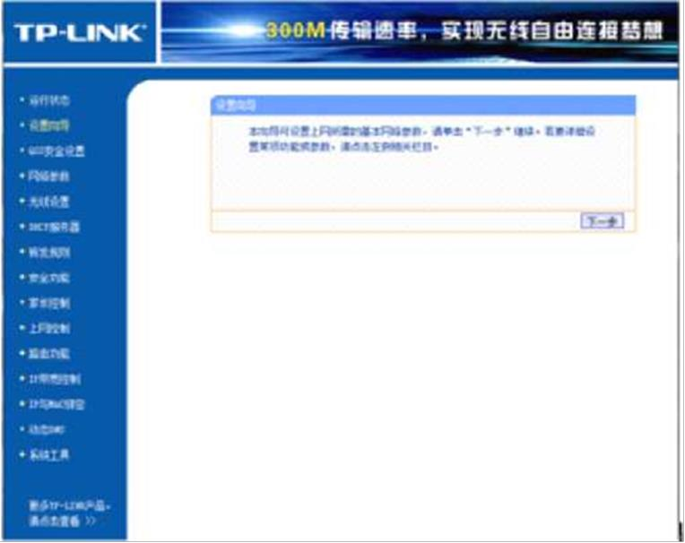

2. QSS 安全设置：家用路由器的 QSS（WPS）可用 PIN 码完成无线配对。不使用时可关闭此功能。

3. 网络参数：

    - WAN 口设置：路由器 WAN 口连接外网的设置。按上游要求选择自动获取、PPPoE 或静态 IP。LAN 口参数包括 IP 地址和子网掩码等。

        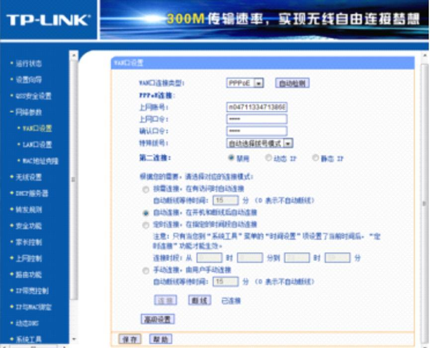

    - MAC 地址设置：路由器 WAN 口的设备地址，以运营商的接入要求为准。

4. 无线设置：

    - 基本设置：设置路由器的 SSID（无线网络的名称）、信道、模式等。

    - 无线安全设置：选择无线加密方式并设置密码。

        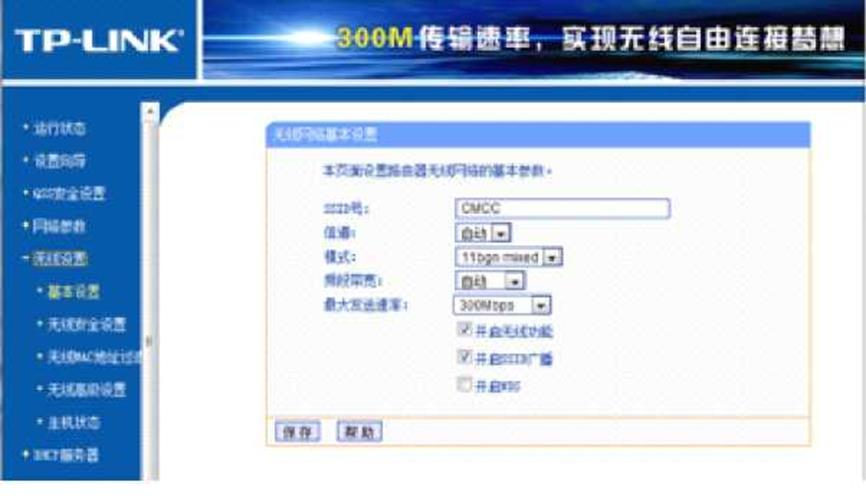

    - 无线 MAC 地址过滤：可将允许接入的设备填入列表。

        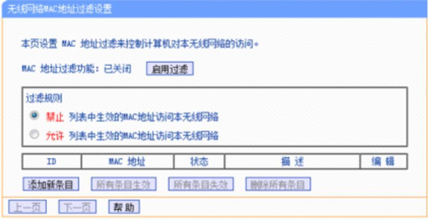

    - 主机状态：查看目前使用无线方式连接到路由器的终端

5. DHCP：

    - DHCP 用于给内部网络或网络服务供应商自动分配 IP 地址，给用户或者内部网络管理员作为对所有计算机作中央管理的手段。

    - DHCP 服务：设置自动分配地址段，地址租期等

    - 客户端列表：DHCP 分配的所有连接路由器的终端

    - 静态地址分配：用于手动给终端分配地址

    - 家用路由器通常通过 DHCP 给局域网终端自动分配地址。

        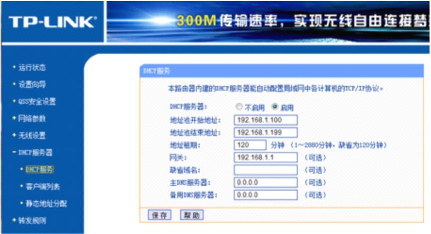

6. 家长控制：列表中的计算机将只能在指定的时间访问指定的网站，其他不在列表中的计算机将不能上网。

7. IP 带宽控制：

    - 控制设置：开启或关闭 IP 带宽控制，设置宽带类型

    - 控制规则：为每个 IP 地址分配宽带设置完成之后既可以按照设置每个人用到不同带宽的宽带，防止合办宽带一个人下载所有人瘫痪。

        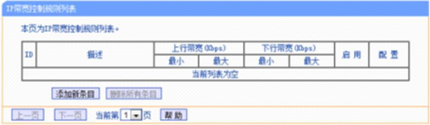

8. IP 与 MAC 绑定：将终端设备的 MAC 与路由器给其分配的 IP 绑定。

    

9. 系统工具：看看就会知道的，建议修改登录口令。

    

10. 如何让路由器更安全：

    - 使用路由器和终端支持的 WPA3，或使用 WPA2-AES。为 Wi‑Fi 设置独立的长密码。隐藏 SSID 无法代替加密。

    - MAC 地址过滤可以管理接入名单，主要的安全措施仍是无线加密。

    - 关闭 QSS 功能，如需开启则修改 PIN 码：让其他终端无法知道 PIN 码，不能通过 QSS 连接路由器。

    - 时常关注客户端列表，看看有没有陌生终端接入路由器。如果发现陌生设备，先核对设备归属，确认异常后更换无线密码。

### 无线路由 WAN 口无法获取 IP 地址的故障解决

现在大多数人会选择无线上网的方式进行上网，但是很多人的无线路由器经过设置向导设置后仍无法正常上网且大部分问题都是 WAN 口无法获取 IP 地址（如图所示）。下面我们就来寻求下该问题的解决办法。

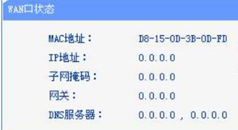

1. 检查线路连接：

    宽带线路（入户网线或从 Modem 出来的网线）需连接在路由器的 WAN 口，有线电脑需连接在 LAN 口，如下图：

    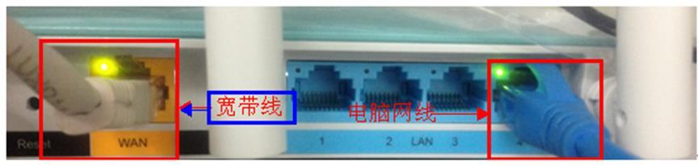

    如果线路连接正确，但 WAN 口指示灯不亮，则检查 WAN 口接线是否存在接触不良等情况，请尝试更换连接 WAN 口的网线。

2. 运营商绑定 MAC 地址：

    向运营商确认是否绑定设备，再按运营商指引更新登记。

3. IP 地址段冲突：

    路由器前端网络使用的 IP 地址段与路由器的地址段相同，由于 IP 冲突导致 WAN 口无法获取到 IP。

    解决方法：登录路由器的管理界面，点击网络参数，在 LAN 口设置中将路由器的 IP 地址修改为与上游网络不在同一网段的 IP（可尝试 192.168.0.1 或 192.168.2.1），保存并重启路由器。如下图所示：

    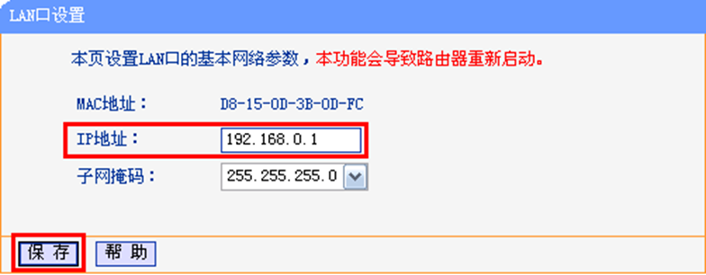

4. 线路适配问题

    入户网线由于老化、质量太差或线路太长，导致线路衰减过大，从而引起 WAN 端口无法获取到参数。尝试调整路由器 WAN 口的速率和双工模式。

    设置方法：登录路由器管理界面，点击网络参数 → WAN 口速率模式，模式设置中选择 10Mbps 半双工或 10Mbps 全双工模式，然后点击保存，如下图所示：

    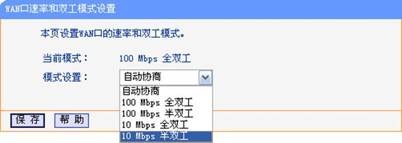

术语见[网络基础：IP、DNS 与 DHCP](network-basics.md)。校园网相关故障见[四川大学校园网接入与排障](campus-network-history.md)。
