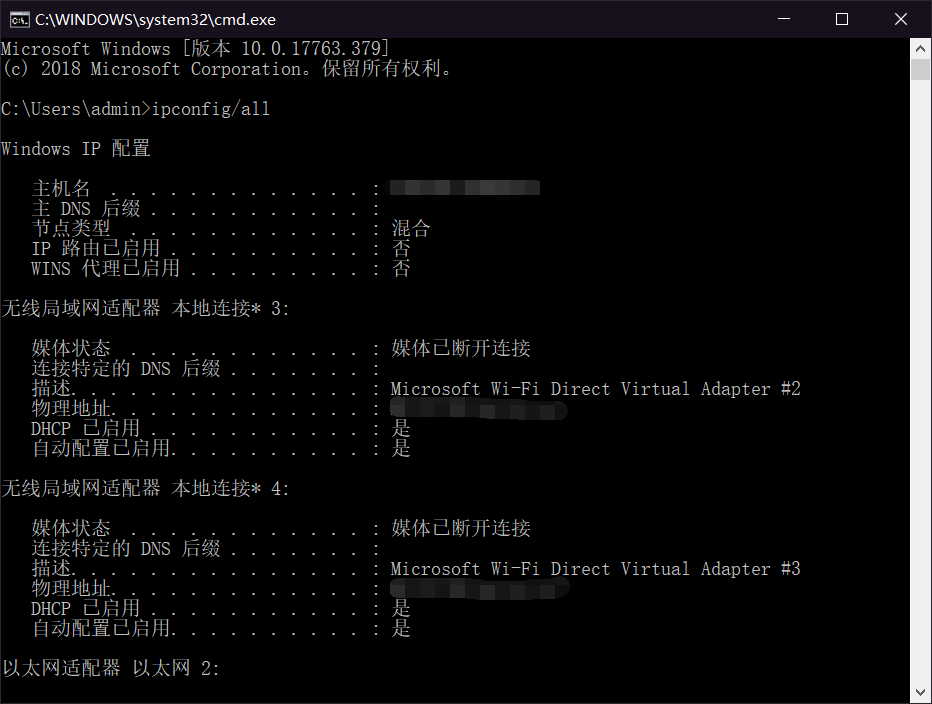
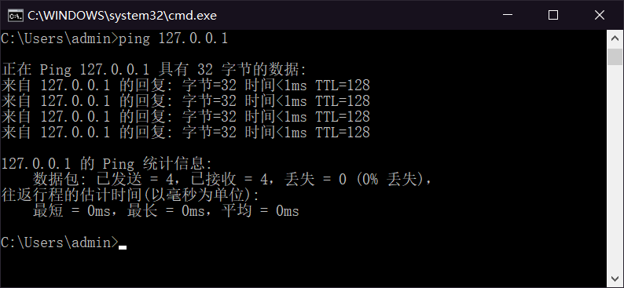
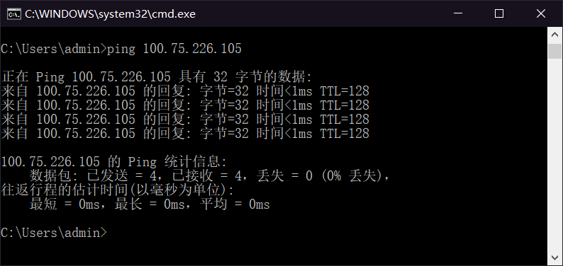
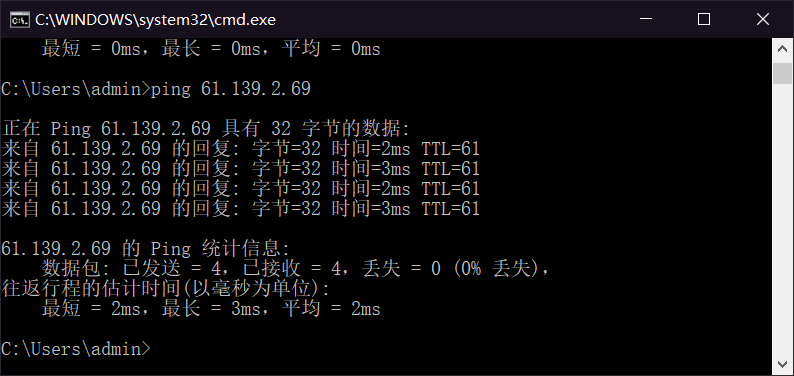
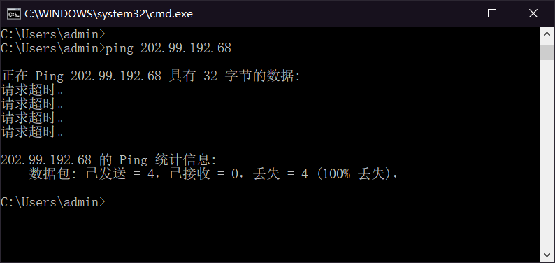
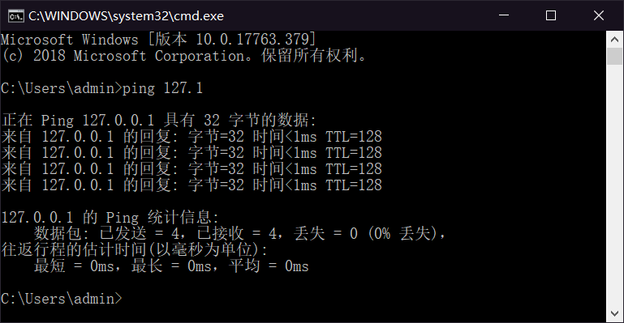

# 连接故障与 ping 诊断

以下保留原手册的 Windows 拨号故障和连通性检查。能否从 ping 收到回复取决于目标是否响应 ICMP，网页或服务仍应单独验证。

## 宽带连接错误

当网络由于各种各样原因无法连接时，拨号器就会报错，这样的错误经常以代码的形式给出。而面对这样的几个数字时，操作者往往会一头雾水，上网百度？可是面对网络上密密麻麻的几百行文字，不免心底怕怕。其实只要知道几个常见的宽带错误代码，我们就可以轻松地解决问题，下面就让我们看一下都有什么吧？以下列出了一些常见错误代码和相应的可行的解决方法。

- 605 不能设置端口信息

    方法：删除并重新创建“网络和拨号连接”；

- 612 指定的路由未分配

    方法：网络配置可能不正确，重新启动计算机即可；

- 615 未找到指定的端口

    方法：重新配置“网络和拨号连接”，如果错误仍然存在，删除并重新创建“网络和拨号连接”；

- 619 指定的端口未连接

    方法：重新启动计算机；

- 620 无法决定端点

    方法：网络配置可能不正确，重新启动计算机，如果错误仍然存在，请参照事件查看器，查找详细的警告或错误；

- 630 没有合适的网卡或驱动

    方法：检查网卡是否工作，网络线路是否插好，重新安装网卡驱动程序并确定网卡正常工作；

- 651 由于用户端原因 （拨号软件、网卡驱动、计算机系统、网线等）或运营商部分（局端设备、设备端口），多数情况下由于外部网络断线，或者设备出现了问题导致不通；

    方法：

    1. 网线没接上，重新插拔网线或更换网线；

    2. 网卡驱动问题，在设备管理器中检查网卡驱动，按设备厂商说明更新。

- 678 宽带线路问题。方法：关闭路由器或猫，把所有线路重新插拔一下，等 3~5 分钟开路由，开电脑，再连接宽带；

- 691 由于域上的用户名或密码无效而拒绝访问

    方法：

    1. 用户名密码填写错误，重新填写即可；

    2. 宽带欠费，请及时续费；

- 769 本地连接或网卡出现问题，可能是本地连接被禁用、网卡松动、网卡驱动丢失造成的

    方法：

    1. 如果是本地连接被禁用，双击启动即可；

    2. 网卡问题，更新驱动后如果还不行，再排查网卡硬件。

网络错误代码大致是这样，其实如果我们不想自己检查的话，遇到网络连接其实试一试 360 断网急救箱其实一般就可以解决了。

## ping 的介绍及操作

ping 在 Windows 系统下是自带的一个可执行命令，利用它可以检查网络是否连通，并可以很好地帮助我们分析判定网络故障。它使用 ICMP 回显请求和应答来测试连通性。其基本应用格式为：ping 地址，方法为开始 → 运行 → cmd。并且 Ping 不仅是 Windows 下的命令，在 unix 系统和 linux 系统下也有这个命令，下面让我们来一探 ping 的庐山真面目！

### Ping 的概念

Ping（Packet Internet Groper），因特网包探索器，用于测试网络连接量的程序。Ping 是一个 DOS 命令，一般用于检测网络通与不通，也能查看往返时延。

### Ping 的工作原理

利用网络上机器 IP 地址的唯一性，给目标 IP 地址发送一个数据包，在要求对方返回一个同样大小的数据包来确定两台网络设备是否连通，往返时延是多少。Ping 指的是端对端连通，通常用来作为可用性检查，但某些病毒木马会强行大量远程执行 ping 命令抢占机器的网络资源，导致系统变慢，网速变慢。

### Ping 的操作

连通问题是由许多原因引起的，如本地配置错误、远程主机协议失效等，当然还包括设备等造成的故障。使用 ping 命令检查连通性有六个步骤：

1. 使用 `ipconfig /all` 观察本地网络设置是否正确

    

2. 运行 `ping 127.0.0.1` 测试本机回环地址，检查本地 TCP/IP 协议栈。

    

3. ping 本机 IP 地址，这样是为了检查本机的 IP 地址设置是否有误；

    

4. ping 本网网关或本网 IP 地址，这样是为了检查硬件设备是否有问题，也可以检查本机与本地网络连接是否正常，在非局域网中这一步骤可以省略；

5. ping 本地 DNS 地址，检查能否连到该 DNS 服务器。域名是否能解析，可另用 `nslookup example.com` 检查。

    

6. ping 远程 IP 地址，这主要是检查本网或本机与外部连接是否正常。

### Ping 操作的返回错误

在检查网络连通的过程中可能出现一些错误，这些错误总的来说有两种最常见。

1. Request timed out

    

    也称请求超时，这个提示可能是由于对方可能装有防火墙或已关机，或者由于本机 IP 不正确和网关设置错误。

    IP 地址不正确主要是 IP 地址设置错误或 IP 地址冲突，这可以利用 `ipconfig /all` 来检查；

    网关设置错误主要是网关地址设置不正确或网关没能帮你转发数据，还有可能是远程网关失效。

2. Destination host unreachable

    如果局域网中使用 DHCP 分配 IP 时，而碰巧 DHCP 失效，这是 ping 命令就会产生此错误，因为 DHCP 失效时客户机无法分配到 IP，此时系统只好自设 IP，它往往不同于子网的 IP，于是出现此错误。

    另外子网掩码设置错误也会出现此错误。

### ping 命令小技巧

#### 旧版 Windows 中的回环地址简写

在使用“ping 127.0.0.1”命令来验证本机 TCP/IP 协议是否被正确安装时，发现使用“ping 127.1”也能得到相同结果，为什么会这样呢？这是因为其实这两条命令是相同的，IP 地址是由 32 位二进制数组成的，为了方便记忆，把每 8 位二进制数换算成十进制数，从而构成常见的 IP 地址（如 127.0.0.1），由于 Windows 系统具有自动填充“.0”的功能，所以“127.0.0.1”就可以变为“127.1”。但是这种省略是有条件的，在 ping 命令中，只能将在 IP 地址的最后一个十进制数前出现的一个或多个“.0”省略，也就是说“202.0.9.1”不能写成“202.9.1”。

## 浏览器内核及常见浏览器

以下是手册成书时的浏览器及其内核记录。

浏览器是我们网络生活中离不开的一个工具，现在就让我们来探一探浏览器的面目吧。

浏览器最重要或者说核心的部分是“Rendering Engine”，可大概译为“解释引擎”，不过我们一般习惯将之称为“浏览器内核”。负责对网页语法的解释（如 HTML、JavaScript）并渲染（显示）网页。所以，通常所谓的浏览器内核也就是浏览器所采用的渲染引擎，渲染引擎决定了浏览器如何显示网页的内容以及页面的格式信息。不同的浏览器内核对网页编写语法的解释也有不同，因此同一网页在不同的内核的浏览器里的渲染（显示）效果也可能不同，这也是网页编写者需要在不同内核的浏览器中测试网页显示效果的原因。

浏览器内核很多，若加上几乎没人用的内核，可能有 10 款甚至更多，不过常见的只有以下 4 种。我们把使用自己研发的内核的常见浏览器称主流浏览器，它们是(按流行程度排序)Google Chrome、Windows Internet Explorer、Mozilla Firefox 和 Apple Safari、Opera 刚刚从主流浏览器变成壳浏览器(壳浏览器指使用别人研发的内核的浏览器)。

国内常见的浏览器还有搜狗高速浏览器、腾讯 TT、360 安全浏览器、360 极速浏览器、傲游浏览器。这些浏览器的内核几乎一致为 Webkit（极速）和 Trident（普通）两种，所以着重介绍一下这些浏览器内核。

Trident（IE 内核）：该内核程序在 1997 年的 IE4 中首次被采用，是微软在 Mosaic 代码的基础之上修改而来的，并沿用到 IE11。Trident 实际上是一款开放的内核，其接口内核设计的相当成熟，因此才有许多采用 IE 内核而非 IE 的浏览器涌现 （如 360 浏览器、Maxthon、The World、TT、Green Browser、Avant Browser 等）。此外，为了方便也有很多人直接简称其为 IE 内核（当然也不排除有部分人是因为不知道内核名称而只好如此说）。

Webkit（Safari）：苹果公司自己的内核，也是苹果的 Safari 浏览器使用的内核。Webkit 引擎包含 Web Core 排版引擎及 Java Script Core 解析引擎，均是从 KDE 的 KHTML 及 KJS 引擎衍生而来，它们都是自由软件，在 GPL 条约下授权，同时支持 BSD 系统的开发。所以 Webkit 也是自由软件，同时开放源代码。在安全方面不受 IE、Firefox 的制约，所以 Safari 浏览器在国内还是很安全的。

Blink（Chrome）：由 Google 和 Opera Software 开发的浏览器排版引擎，自 2013 年 4 月发布，现在 Chrome 的内核是 Blink。Blink 其实是 webkit 的分支，如今大部分国产浏览器最新版都采用 Blink 内核（极速）。

家庭网络的 IP 分配与接线问题见[家庭网络与路由器排障](network-repair-router.md)。

来源：四川大学飞扬俱乐部《维修手册》第四章，印刷第 114–122 页（PDF 第 115–123 页）。
