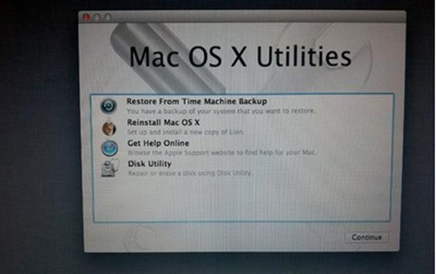
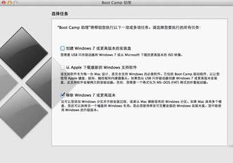

# macOS 恢复与 Boot Camp

> **编注**　恢复方式取决于机型。Intel Mac 可在开机时按 Command + R。搭载 Apple 芯片的 Mac 要在关机后按住电源键，直到出现“选项”。参见 [Apple 官方恢复说明](https://support.apple.com/zh-cn/guide/mac-help/mchlp1599/mac)。Boot Camp 只适用于 [Apple 支持的 Intel Mac](https://support.apple.com/zh-cn/guide/bootcamp-assistant/bcmp173b3bf2/mac)。

## Mac OS X 的重装

原手册以 Intel Mac 的恢复界面为例，介绍重新安装系统和使用磁盘工具。

**1.** 首先在 MacBook Air 关上的情况下，按着 Command 及 R 两个按键不放手， 然后同时按下最右上角的开关键一下(记着此时仍然继续按着 Command + R 键)。

**2.** 当进入至此界面后，就可以放开所有按键。其中有 4 个选项：Restore From Time Machine Backup 是从你过去备份至 Time Machine 的映像档恢复电脑、Reinstall Mac OS X 顾名思义就是重新安装 Mac OS X Lion、Get Help Online 则是从线上撷取帮助文档，了解重装步骤及常见问题、而最后的 Disk Utility 则是管理硬盘，包括：分割磁区、将磁碟区格式化等。

- 需要抹盘时，可以在备份数据后用“磁盘工具”抹除指定宗卷，然后从恢复环境或启动介质安装系统。
- 只需要重装时，选择“重新安装 macOS”，保持联网并按提示操作。

## Mac 双系统的安装

Mac 系统自带的 Boot Camp 助理其实是个很强大的东西，装 Mac 的双系统只要跟着 Boot Camp 的节奏来就好。

**1.** 把要安装的 Windows 镜像挂载在桌面上。

**2.** 打开“启动转换助理”，点按继续。根据机型和系统显示的选项操作。

**3.** 根据机型、Windows 版本及应用需求分配磁盘空间。分区后选择开始安装，电脑会重启进入 Windows 的安装界面。

**4.** 安装 Windows 后运行启动转换安装程序，安装键盘、触控板等所需驱动。Windows 使用有效许可激活。

本篇依据四川大学飞扬俱乐部《维修手册》印刷第 164–165 页（PDF 第 165–166 页）整理。
