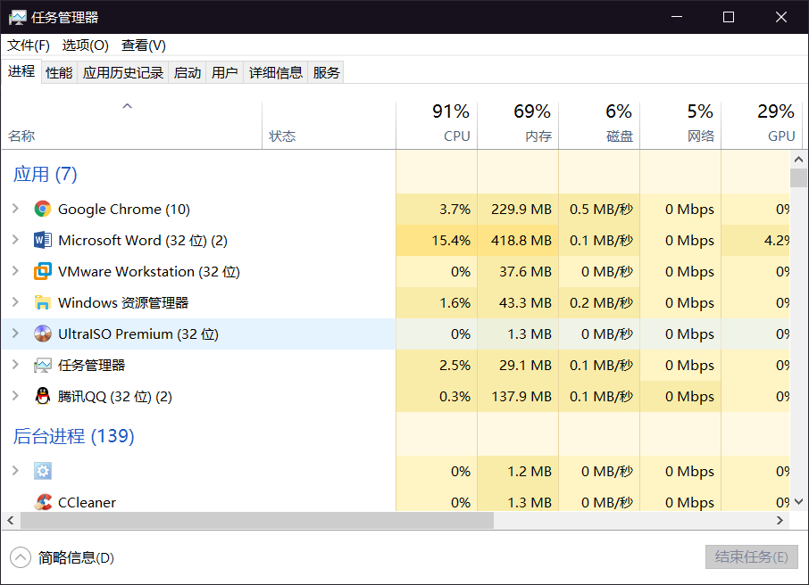
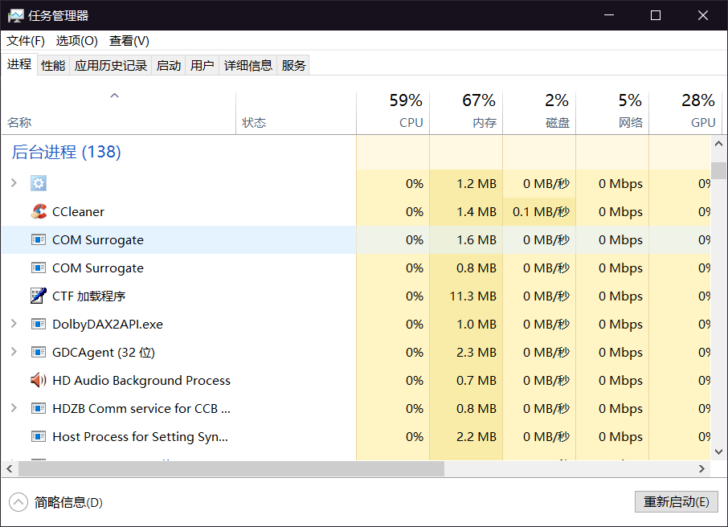
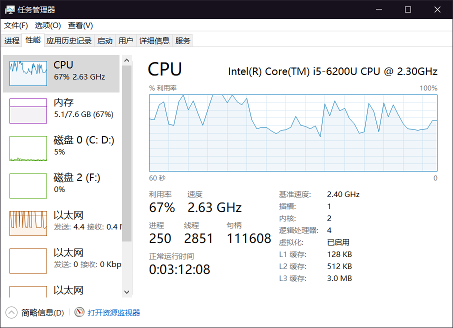
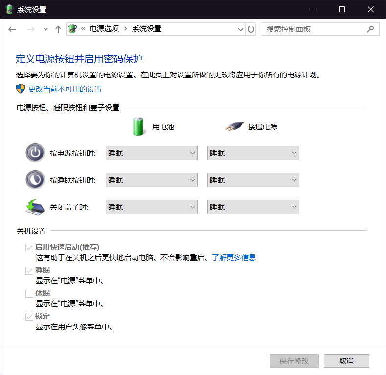
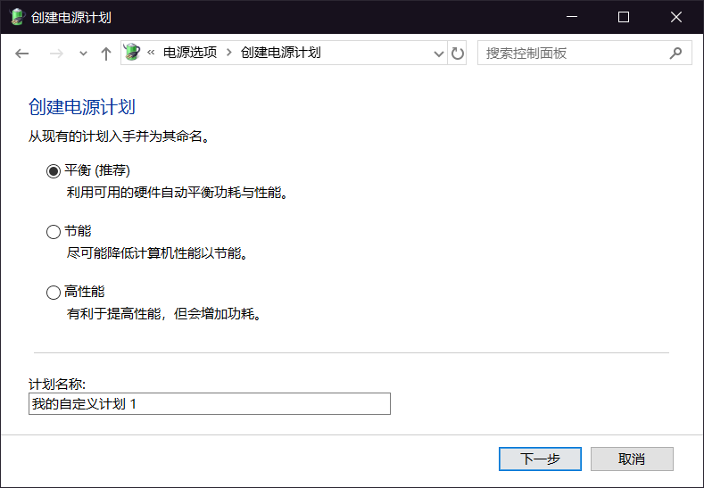
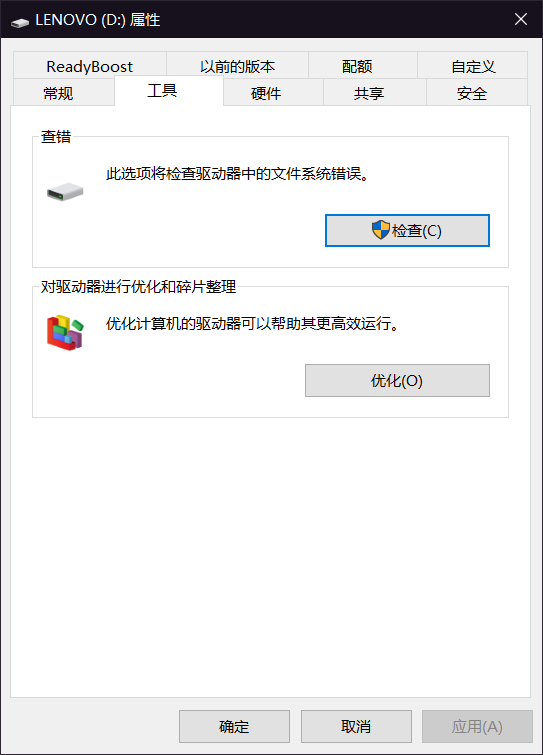
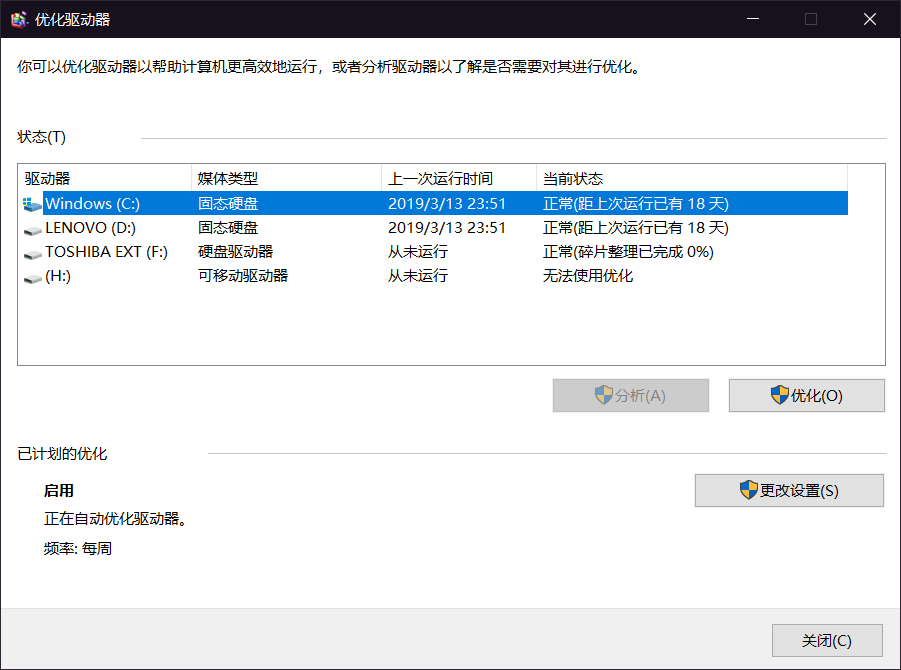

# Windows 日常维护与快捷键

## 常用系统设置与优化

### 打开任务管理器

在电脑最下端的任务栏选择右键，点击“启动任务管理器”；或者在键盘上同时按 Ctrl + Shift + Esc，也可以弹出任务管理器。

在任务栏中可以通过右键 → 结束进程结束停止响应的程序

在任务管理器中可以看到正在运行的进程

点击“性能”可以查看系统目前的 CPU、内存、硬盘、网络的使用情况

### 对硬盘进行合理分区，分类存放数据

如系统、软件、文件资料、娱乐四个分区等对硬盘进行合理分区、合理分配。既便于数据的整理寻找，也方便系统重装。

C 盘不要放过多的文件，要保证有足够的空间。不然会导致系统变慢。安装系统和应用前应准备足够空间，并留出更新和临时文件的余量。

在安装软件时选择自定义，注意它的安装路径，可将其更改到软件分区内。

避免捆绑软件应注意以下几点：

1. 在我们下载软件时，为了方便，一般会在百度搜索下载或者一些管理软件下载。这种情况下，我们下载的软件都会带有捆绑。所以我们最好在软件官网下载，但在安装时，我们也要注意勾选选项，避免下载了其他附带软件；

2. 普通安装包不要无脑快速安装、一键安装，也不要无脑点下一步，最好选择自定义安装，若没有的话每一步都要看看有没有其他选项，就算是英文软件也要多看两眼，一样有推荐主页的选项的；

3. 不要随意下载一些免费软件或者共享软件，一些免费软件经常会捆绑很多软件；

4. 在软件站下载软件时，不要选择高速下载，特别是用所谓的高速下载器下载，（那东西就是个坑）最好选择那个不起眼的本地下载。

### 安装系统更新

在 Windows Update 中检查并安装系统安全更新。

### 调整电源计划

有时是不是一不小心按着电源键或者关下盖子电脑就打瞌睡了。如果不想这样，我们可以改变一下电源计划。

操作如下：在任务栏看到电池的图标，点那个电池 → 更多电源选项 → 选择关闭机盖的功能，里面有详细的设置。

如果你觉得有时电脑不给力，同样我们打开电源的更多选项。把电源计划设为高性能试试。没有使用外接电源时可以选为节能，可以更省电。也可以根据自己的实际情况添加新的计划。

### 整理磁盘碎片

磁盘碎片应该称为文件碎片，是因为文件被分散保存到整个磁盘的不同地方。硬盘在使用一段时间后，由于反复写入和删除文件，磁盘中的空闲扇区会分散到整个磁盘中不连续的物理位置上，从而使文件不能存在连续的扇区里。这样，再读写文件时就需要到不同的地方去读取，增加了磁头的来回移动，降低了磁盘的访问速度。建议一个月整理一次。选中一个磁盘 → 右击 → 属性 → 工具 → 立即进行碎片整理，碎片超过 10%，则需整理，否则不必。原手册以机械硬盘为例。SSD 由 Windows 的“优化驱动器”按存储介质处理。

## 常用 Windows 快捷键

我们记住一些常用的 windows 快捷键，是于我们日常的操作有好处的，既能提高操作的速度，又能在外人面前“秀一番”，何乐不为呢？

- **F1** 显示当前程序或者 windows 的帮助内容。

- **F2** 当你选中一个文件的话，这意味着“重命名”

- **F5** 刷新

- **F11** 在多种浏览器中切换全屏模式。

- **F12** 在编辑好 Excel 或 Word 文档，可“另存为”；当在网页页面，F12 为打开调试环境。

- **Backspace** 如果在“另存为”或“打开”对话框中选中了某个文件夹，则打开上一级文件夹

- **Win 或 Ctrl + Esc** 打开开始菜单。
- **Ctrl + Alt + Delete** 打开安全选项。
- **Ctrl + Shift + Esc** 打开任务管理器；也可从安全选项中打开。
- **Delete** 删除选中的项目，文件通常移入回收站。
- **Shift + Delete** 直接删除选中的文件，跳过回收站。
- **Ctrl + Shift + N** 在资源管理器中创建文件夹。

- **Ctrl + A** 全选文件夹内的文件

- **Ctrl + S** 保存当前操作的文件

- **Ctrl + W** 关闭当前的窗口

- **Ctrl + X** 剪切被选择的项目到剪贴板

- **Ctrl + Insert** 或 CTRL+C 复制被选择的项目到剪贴板（笔记本：FN+CTRL+INSERT=CTRL+INSERT）

- **Ctrl + Shift** 切换中英文输入法和（CTRL+空格的作用一样）

- **Shift + Insert** 或 CTRL+V 粘贴剪贴板中的内容到当前位置(笔记本：FN+SHIFT+INSERT=SHIFT+INSERT）

- **Alt + Backspace** 或 CTRL+Z 撤销上一步的操作

- **Alt + Shift + Backspace** 或 CTRL+Y 重做上一步被撤销的操作

- **Alt + F4** 关闭当前应用程序

- **Alt + Tab** 切换当前程序 （加 SHIFT 反向）

- **Alt + Esc** 切换当前程序 （加 SHIFT 反向）

- **Win + B** 选中桌面右下方工具栏

- **Win + D** 显示桌面

- **Win + E** 打开我的电脑

- **Win + F** 的功能因 Windows 版本而异，原手册记录了旧版的搜索和反馈中心用法。

- **Win + M** 最小化所有窗口

- **Win + Shift + M** 将最小化的窗口还原到桌面

- **Win + R** 打开“运行”对话框

- **Win + U** 打开辅助工具管理器

- **Win + Break** 打开“系统属性”对话框
