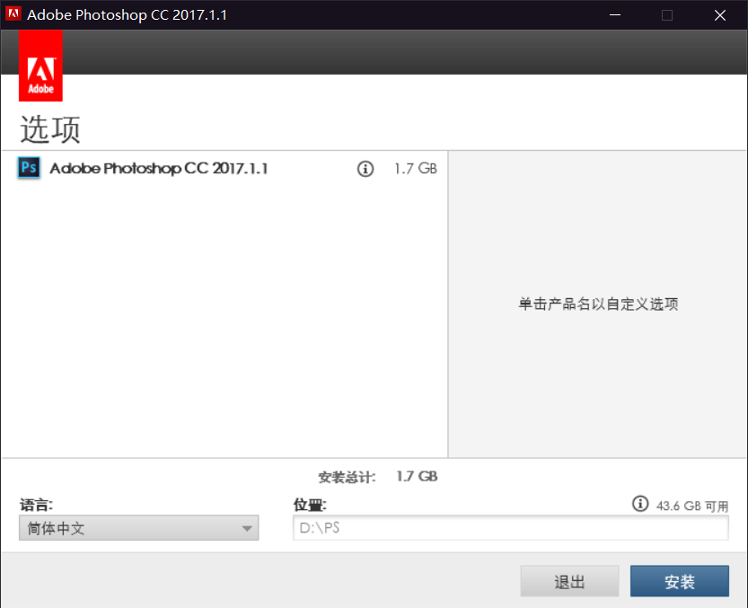
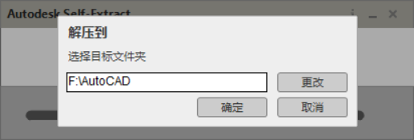

# 安装 Adobe 与 AutoCAD

## Adobe 系列软件安装

我们经常使用的 PS、PR、AE 等软件就是 Adobe 公司出品的，接下来我们以 PS CC 为例进行讲述。

> **编注**　此节以手册中的 Photoshop CC 为例。当前从 [Adobe 官方帮助](https://helpx.adobe.com/cn/download-install/apps/download-install-apps/creative-cloud-apps/download-creative-cloud-desktop-app-using-direct-links.html)下载 Creative Cloud，使用具有许可的账户登录后选择产品和版本。下图是旧版安装界面。

**1.** 选择要安装的 Adobe 应用，然后点击安装。

**2.** 等待安装完成。

## AutoCAD 安装

AutoCAD 是许多工科生都会用到的软件，下面我们以 AutoCAD 2018 为例进行讲解。

> **编注**　下列截图记录的是 AutoCAD 2018 的安装流程。当前安装从 Autodesk 官方账户下载。符合条件的学生和教师可申请 [Autodesk 教育许可](https://www.autodesk.com.cn/support/account/education/students-educators/overview)。

**1.** 双击打开官方安装程序，然后选择安装解压路径。

**2.** 待解压完成后，选择安装。

**3.** 选择我接受，下一步

**4.** 选择要安装的软件和安装路径

**5.** 安装完成后，登录 Autodesk 账户并按已授予的许可使用。

本篇依据四川大学飞扬俱乐部《维修手册》印刷第 200–206 页（PDF 第 201–207 页）整理。
