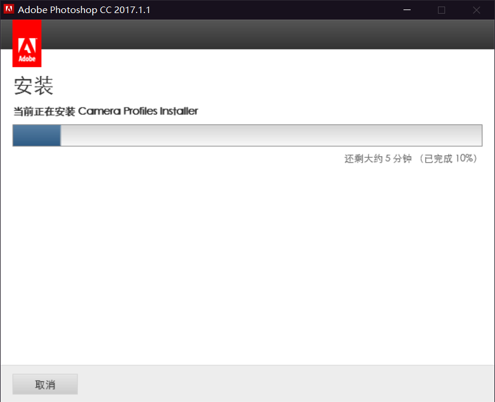
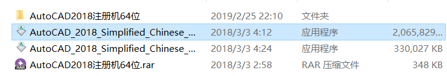
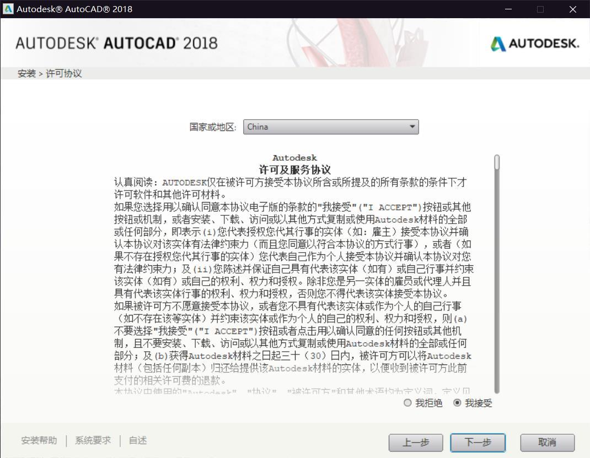

# 安装 Adobe 与 AutoCAD

## Adobe 系列软件安装

我们经常使用的 PS、PR、AE 等软件就是 Adobe 公司出品的，接下来我们以 PS CC 为例进行讲述。

**1.** 打开 [Creative Cloud](https://helpx.adobe.com/cn/download-install/apps/download-install-apps/creative-cloud-apps/download-creative-cloud-desktop-app-using-direct-links.html)，选择要安装的 Adobe 应用，然后点击安装。

**2.** 等待安装完成。

## AutoCAD 安装

AutoCAD 是许多工科生都会用到的软件，下面我们以 AutoCAD 2018 为例进行讲解。

**1.** 双击打开官方安装程序，然后选择安装解压路径。

**2.** 待解压完成后，选择安装。

**3.** 选择我接受，下一步

**4.** 选择要安装的软件和安装路径

**5.** 安装完成后，登录 Autodesk 账户并按已授予的许可使用。

