# 安装 Windows 与迁移系统

## 使用 Windows 安装介质

系统的安装包常称为镜像。`.iso` 是光盘映像格式，其中可能含有 `.wim` 或 `.esd` 形式的 Windows 安装映像。旧版 Ghost 工具使用 `.gho`。

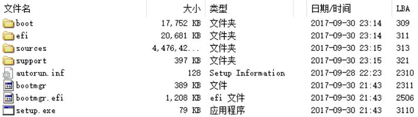

根据镜像格式，可以选择原版安装、映像部署或 Ghost 还原。原版安装可在系统里打开 `setup.exe`，也可用安装 U 盘启动。在系统内运行安装程序时，先检查“更改要保留的内容”能否保留文件与应用。

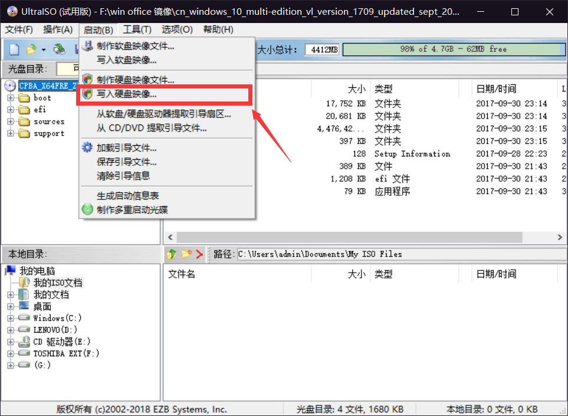

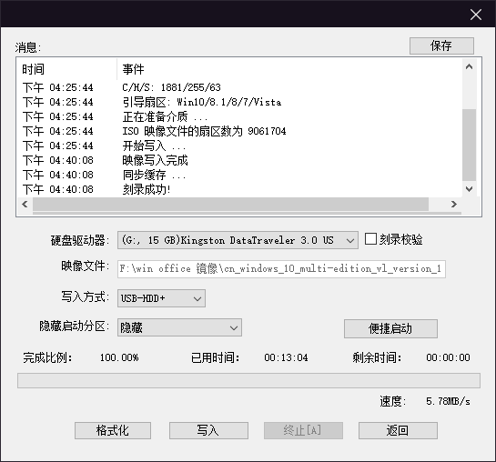

再开机要选择从启动盘启动（有的可以直接开机按 F12 选择，有的需要在 bios 里更改第一启动硬件再重启）。

启动之后会出现这样的画面（以 win10 为例，win7、8 相似），

之后进入安装页面，开始选择语言和输入法等

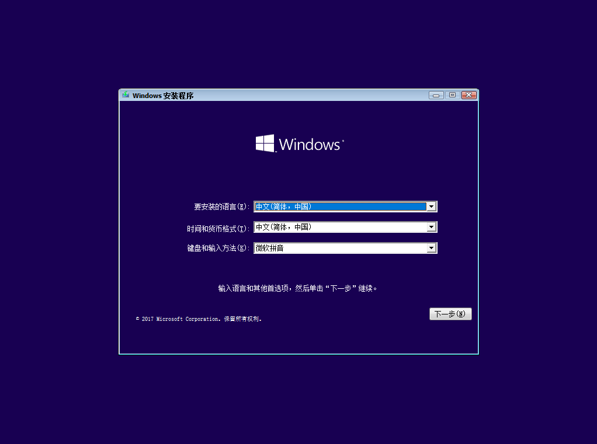

点击现在安装

选择要安装的操作系统版本，核对所选版本与已有许可证一致。

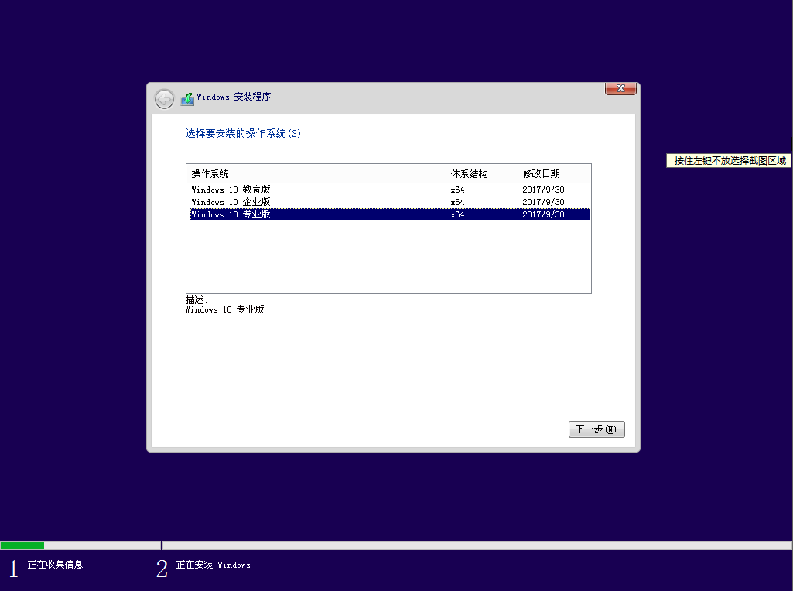

确认所需资料已备份，并明确需要全新安装时，选择“自定义安装”。

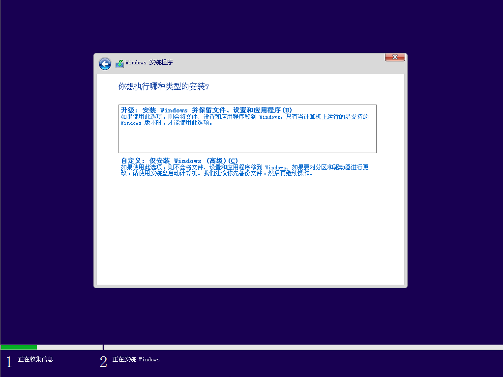

如果目标硬盘是空白盘，可选中未分配空间后继续，安装程序会建立所需分区。如果硬盘已有资料，先按容量与型号核对目标盘和目标分区。

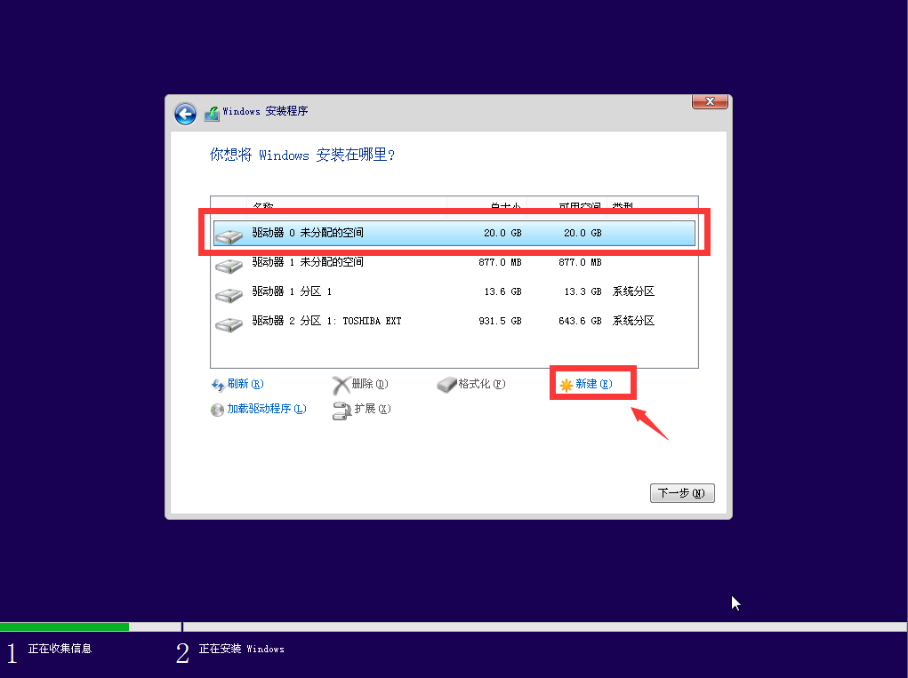

分区完成

开始安装系统

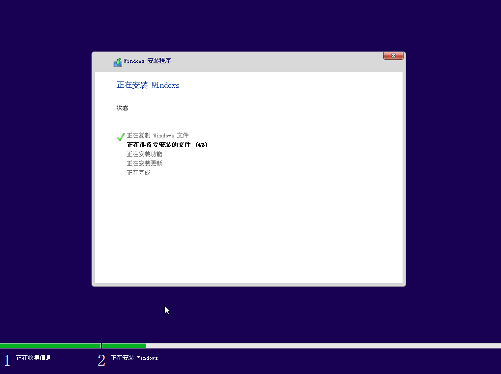

经过几次重启

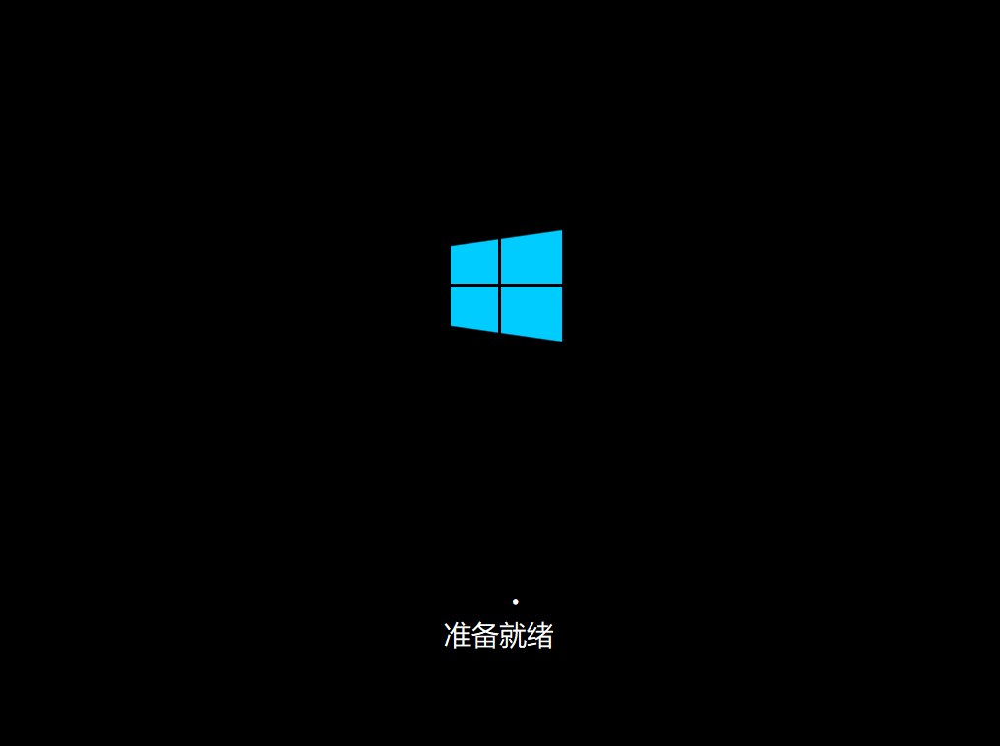

开始设置基本信息：选择地区、输入法、账户设置等等，一直下一步就好。

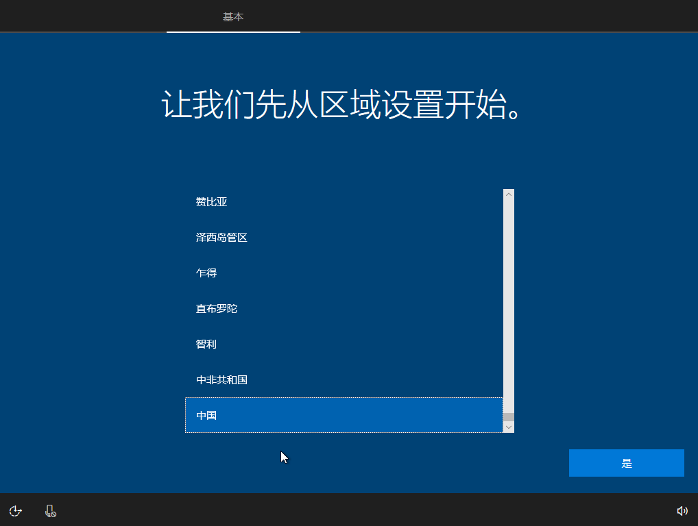

“嗨，别来无恙啊！”稍等一会，就可以进入系统了

安装成功！

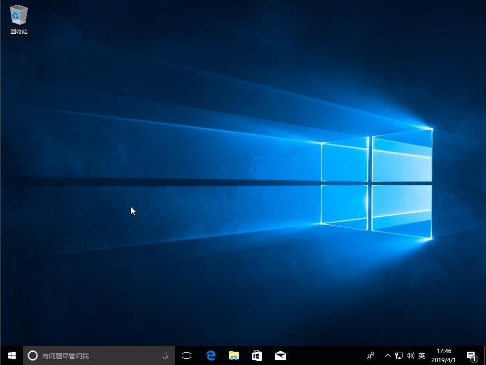

PS：

**1.** 在安装成功后一般只有个回收站图标，要在个性化中把我的电脑调出

**2.** 安装完成后检查驱动。可从 Windows Update 或设备厂商获取所需驱动，例如网卡、存储和芯片组驱动。

**3.** 通过有效产品密钥或数字许可证激活。

**4.** 装上机主要求的软件

**5.** 从 Windows Update 安装系统所需的更新。

## WinPE 与映像部署

下面介绍 win 安装器安装，（仍然以 win10 为例）首先需要制作一个 pe 盘，（与制作启动盘步骤相同，只是将 windows 镜像换成 pe 镜像。其次向上面所说的进入启动盘一样的方法进入 PE。

一般情况下我们遇到的电脑都选择 windows8pe，进入之后大概是这个页面

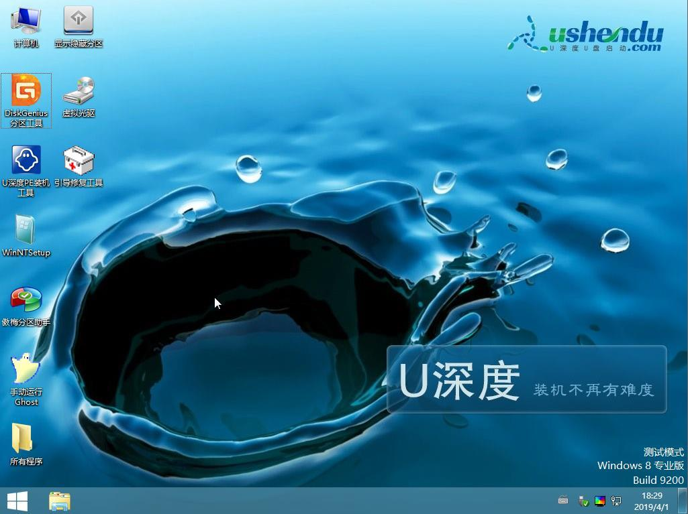

在不用对分区做调整的情况下，我们直接选择打开 WinNT setup（图中为从上往下数第 4 个）得到如下界面：

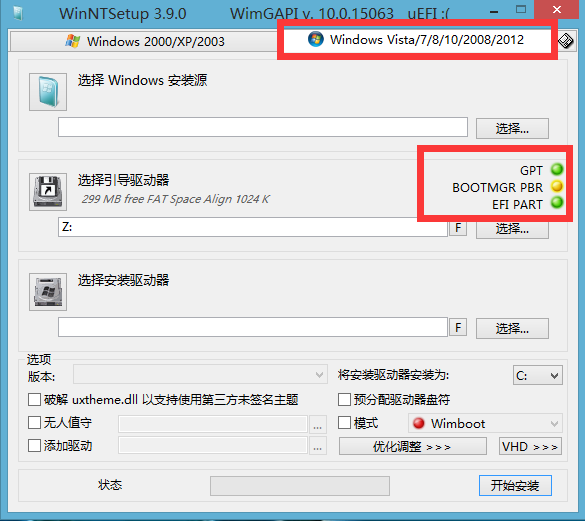

选择右边 win Vista/7/8/10

在解压后的镜像文件或者用虚拟光驱加载好的文件里选择 sources 文件夹中的 Install.wim，在右边三个全为勾（或者为绿或黄）的情况下，选择好引导驱动器和安装磁盘的位置，点击开始安装，完成后选择从系统安装到的硬盘重启（若之前修改过硬盘启动顺序的记得修改回来），后面步骤与原版安装相似。

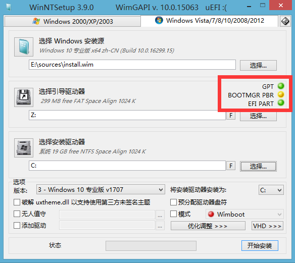

PS：

**1.** Win XP、2000 系统在安装时可以使用 WinNT setup 安装器，也可以用手动 ghost 的方法，在这里就不介绍手动 ghost 了，希望大家自己了解。

**2.** 除了我们飞扬自己做的 PE、it 天空、微 PE、U 深度的之外，其他的老毛桃之类的 pe 一般嵌有广告，不建议使用。

**3.** wim 安装器不止 WinNT setup 这一种，还有许多其他的，大家可以自行了解。

## 启动方式与分区形式

截图中的状态灯随所用启动方式而变。现代电脑通常用 UEFI 与 GPT。旧机型也可能用传统 BIOS 兼容模式与 MBR。

下面两图左为 MBR，右为 GPT（图中标作 GUID）。

安装时，固件启动模式和硬盘分区形式应当对应。传统 BIOS 兼容模式配合 MBR，UEFI 模式配合 GPT（旧工具有时显示为 GUID）。

其次我们在第三章有讲到过 MBR 引导启动的硬盘分区表类型为 MBR 类型，而 UEFI 引导启动的硬盘分区表类型为 GUID 分区表，所以如果我们要使用 MBR/UEFI 引导启动，需要保证硬盘分区表类型为 MBR/GUID 类型，具体的设置方式可以用多个软件完成，下面以 DG 为例：

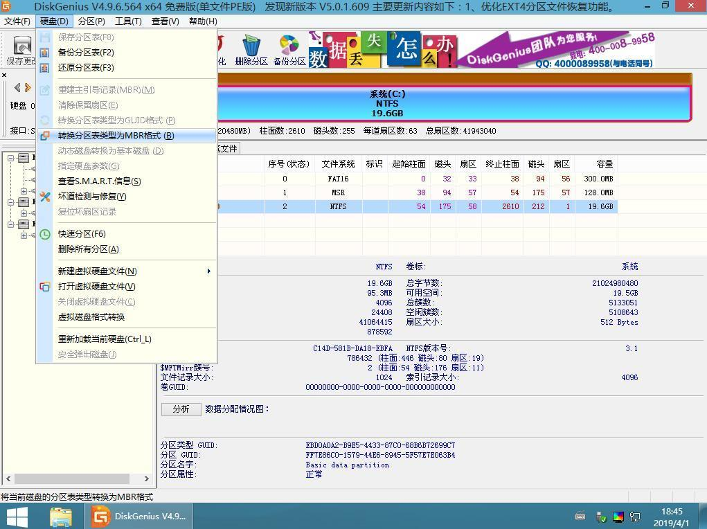

使用传统 BIOS 与 MBR 时，活动分区用于存放引导文件。使用 UEFI 与 GPT 时，EFI 系统分区（ESP）存放引导文件。Windows 安装程序会为目标硬盘创建所需分区。

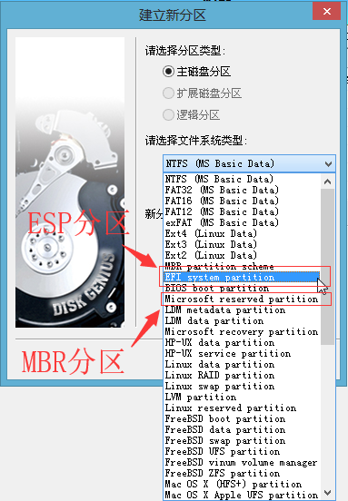

如图选择 EFI System Partition 即为 ESP 分区，Microsoft reserved partition 即为 MSR 分区。

使用 MBR 启动时，引导驱动器为对应的活动分区。使用 UEFI 启动时，引导驱动器为 ESP，Windows 的安装目标则是相应系统分区。少数旧电脑只支持传统模式，有些固件也把兼容模式显示为 CSM。

## 迁移系统到 SSD

现在越来越多的人会选择给自己的电脑加上固态硬盘，这就涉及到了系统和资料搬迁的问题，下面介绍一个简单的系统搬迁工具——傲梅分区助手。具体做法如下：

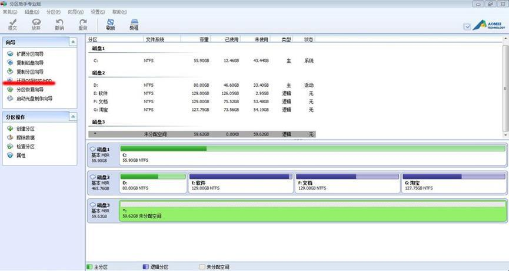

打开分区助手，选择“迁移系统到 SSD/HDD”，接下来选择目标盘。

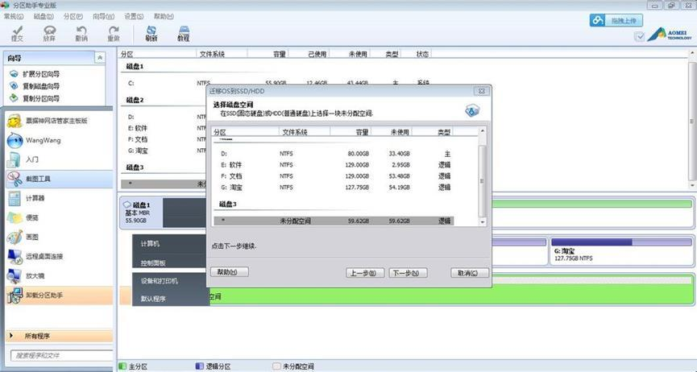

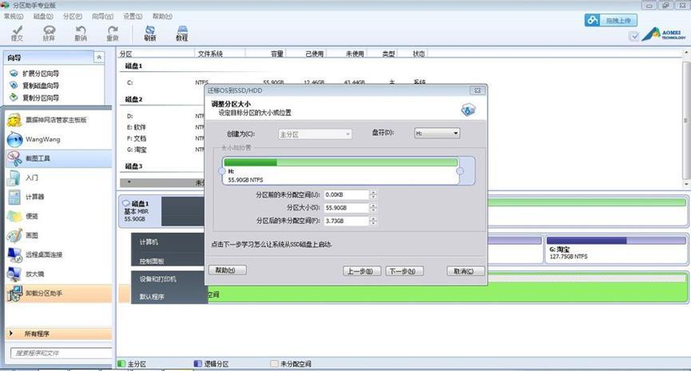

最后点击提交，电脑会自动重启，等待进度条读完后就成功了。

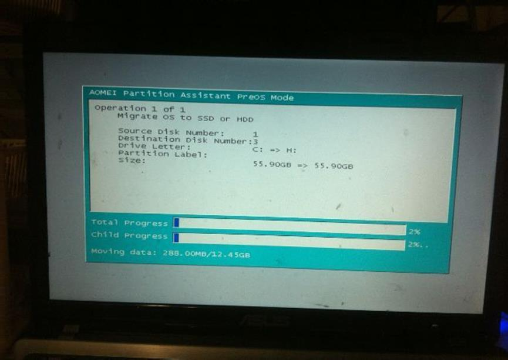

PS：

**1.** 选定用于迁移的空间，并核对工具提示的分区覆盖范围。目标盘已有资料时先完成备份。

**2.** 少部分电脑在点击提交重启后不能自动进入读条界面，这个时候要选择启动硬盘为系统将要迁移到的那个硬盘重启。

**3.** 迁移完成后从启动菜单选择新盘，核对能否独立启动。确认新盘上的系统和资料都正常后，再处理旧盘。

常规重装参见微软的[使用安装介质重新安装 Windows](https://support.microsoft.com/zh-cn/windows/deployment/install-upgrade/reinstall-windows-with-the-installation-media)。分区方式参见 [Windows 安装与 MBR/GPT](https://learn.microsoft.com/zh-cn/windows-hardware/manufacture/desktop/windows-setup-installing-using-the-mbr-or-gpt-partition-style)。
