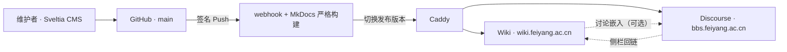

# 飞扬 Wiki v3

维修手册由原版 Material for MkDocs 渲染。Sveltia CMS 在浏览器里编辑 GitHub 上的 Markdown，Discourse 在独立子域名运行。



## Windows 本地预览

安装 Python 3.12，在 **wiki-v3** 目录执行。脚本会创建虚拟环境并启动 MkDocs 开发服务器。

```powershell
powershell -ExecutionPolicy Bypass -File .\scripts\dev-wiki.ps1
```

- [首页](http://127.0.0.1:8000/) · [计算机启动与排障](http://127.0.0.1:8000/handbook/startup/) · [文档编辑](http://127.0.0.1:8000/admin/)
- 右上角可切换浅色、深色。搜索框输入「重装」可查找相关章节。
- Chrome 或 Edge 的编辑入口可选择本地 Git 工作副本，无需 GitHub 登录。选包含 `wiki-v3/` 的仓库根目录。修改 Markdown 后，预览会自动刷新。
- Wiki 预览的「问答社区」指向 [本地 Discourse](http://127.0.0.1:8080/)。如果本地论坛用了其他端口，在启动 Wiki 前设置 `$env:BBS_URL`。

这台电脑上的论坛使用 Docker Desktop 和官方 Discourse standalone 容器，数据保存在 Docker 命名卷。若容器停止，启动 Docker Desktop 后运行 `docker start feiyang-wiki-v3-local-bbs` 恢复预览。

手册已迁移。若需从同一仓库的旧版 `docs/` 重新生成这批文档，先保存 v3 的独立更改，再执行 `node scripts/migrate-docs.mjs`。

在 `wiki-v3/wiki/` 中执行严格构建。下面的开关仅关闭上游维护周期提示。Material for MkDocs 9.8.2 将维护到 2027 年 5 月 5 日。

```powershell
$env:NO_MKDOCS_2_WARNING = '1'
.\.venv\Scripts\mkdocs.exe build --strict
```

## Linux 上线

1. 将 `wiki-v3/` 合并到配置仓库的 `main`。本模板从公开 GitHub 仓库拉取。准备 Linux 4 核 32 GB 主机，将 Wiki、论坛两个独立域名指向它，并让 Caddy 使用公网 TCP 80、443。
2. 安装 [官方 Discourse Docker](https://github.com/discourse/discourse_docker)。复制 [app.yml.example](discourse/app.yml.example) 到 `/var/discourse/containers/app.yml`，填域名、管理员和 SMTP。按 [社区初始化清单](discourse/setup-checklist.md) 核对私有 Docker 网关，启动论坛并配置主题、分类和采纳。
3. 进入 `wiki-v3/deploy/`。复制 `.env.example` 为 `.env`，填两个域名、GitHub 仓库和 `openssl rand -hex 32` 生成的 `GITHUB_WEBHOOK_SECRET`。然后启动 Caddy 和构建容器，并生成首个版本。

   ```sh
   docker compose up -d --build
   docker compose exec wiki-builder /usr/local/bin/build-wiki
   ```

4. 在 GitHub 仓库添加 Webhook。地址为 Wiki 域名加 `/_hooks/wiki-rebuild`，内容类型选 `application/json`，填同一密钥，订阅 Push 事件。验证签名且目标为 `main` 后才触发严格构建。构建成功再切换发布版本，失败时继续提供当前版本。用 `docker compose logs -f wiki-builder` 查看结果。
5. 验证论坛允许嵌入 Wiki 后，在 `.env` 填 `DISCOURSE_URL=https://bbs.feiyang.ac.cn/`（替换成实际论坛域名），运行 `docker compose up -d wiki-builder` 并重新构建。留空时文章不加载论坛。

更换 GitHub 仓库时，同步修改 [CMS 配置](wiki/docs/admin/config.yml) 的 `backend.repo`。更换论坛域名时，更新 `.env` 的 `BBS_DOMAIN` 以及 Discourse 的域名和白名单。Wiki 导航和正文链接使用同一配置。

### 内网部署

如果服务器已有反向代理占用 80 或 443，可让 Caddy 只绑定内网地址，并使用独立端口。以下示例中的 `192.0.2.10` 需要替换为服务器的内网地址。将配置写入服务器上的 `.env`，同时保留已设置的 `GITHUB_WEBHOOK_SECRET`。

```dotenv
CADDY_WIKI_ADDRESS=http://192.0.2.10
CADDY_BBS_ADDRESS=http://192.0.2.10:8080
BBS_UPSTREAM=host.docker.internal:18083
WIKI_SITE_URL=http://192.0.2.10:18081/
BBS_URL=http://192.0.2.10:18082/
```

将以下内容保存为服务器上的 `compose.private.yml`，用 Compose 2.24.4 或更新版本启动。将 Discourse 的 HTTP 端口绑定到 Docker 网桥地址的 `18083`，并把论坛站点 URL 配成 `BBS_URL`。

```yaml
services:
  caddy:
    ports: !override
      - "192.0.2.10:18081:80"
      - "192.0.2.10:18082:8080"
```

```sh
docker compose -f docker-compose.yml -f compose.private.yml up -d --build
docker compose -f docker-compose.yml -f compose.private.yml exec wiki-builder /usr/local/bin/build-wiki
```

如果 Wiki 和论坛使用同一主机名但端口不同，将论坛侧栏的「维修知识库」链接设为 `/_wiki/`。Caddy 会将该地址重定向到 `WIKI_SITE_URL`。

若 GitHub 无法访问内网的 Webhook，推送后执行上面的构建命令发布。需要自动构建时，再为签名 Webhook 配置 GitHub 可访问的 HTTPS 入口。

## 编辑和发布

线上 CMS 默认使用 GitHub PAT。给维护者签发仅适用于目标仓库、可读写 Contents 的细粒度令牌，按仓库规则提交。需要 OAuth 时，部署 [官方 Sveltia CMS Authenticator](https://github.com/sveltia/sveltia-cms-auth)，在 `backend` 填 `base_url` 并把 `auth_methods` 加上 `oauth`。新增、删除或移动文章时，通过 Git 变更同时维护 `wiki/mkdocs.yml` 的导航。
